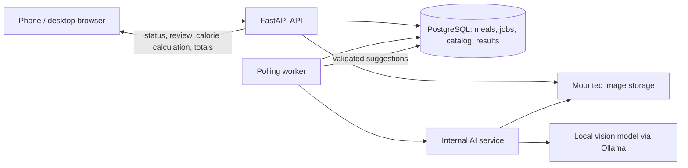

# Photo-assisted Calorie Tracking App

Course project for **MAIE 6000C — Engineering AI Products: From Prototype to Production**.

Team: **group14** — Zhang Boxiang, Yang Sibo, Wang Ziyang, Li Zimu.

## Product and primary user

The app helps an individual record meals with less manual food searching. A meal photo produces food suggestions; the user corrects them and supplies portion weights; the system calculates approximate calories from a traceable nutrition catalog and saves the meal to a daily log.

```text
Take/upload a meal photo
→ asynchronous food recognition
→ confirm/correct foods and edible portion weights in grams
→ calculate estimated calories
→ save the confirmed meal
→ view meal history and daily total
```

Calories are estimates based on selected foods and supplied weights. A photo alone does not establish portion weight, hidden oil, or exact recipe composition. AI suggestions always require user confirmation.

## Week 4 scope

The MVP is a responsive web app usable from a phone browser: one photo per meal, a small supported food catalog, editable food suggestions, user-entered grams, persisted meal history, and daily calorie totals.

Personalized diet plans, body-profile collection, weight prediction, native mobile apps, social features, and disease-specific advice are outside this MVP. The app supports meal recording for general wellness.

## Implementation status

**Week 4 is an architecture proposal, not a completed calorie-tracking application.** Meal features, the catalog, browser UI, model adapter, and schema are proposed work.

Executable code still implements the starter case-triage domain:

- FastAPI API and separate AI service;
- PostgreSQL with `cases` and `jobs` tables;
- database-persisted jobs and a polling worker;
- deterministic keyword-based `/triage`, not a vision model;
- Alembic, Docker Compose, health endpoints, structured logs, and tests;
- the Week 3 addition `GET /cases/{case_id}/jobs`.

Concurrency-safe claims, automatic retries, and expired-claim recovery are planned adaptations, not existing worker capabilities.

## Proposed architecture



The API owns meal records, user corrections, deterministic calorie calculations, and daily aggregation. The worker owns slow recognition jobs. The AI service returns structured food suggestions, not authoritative calorie values.

Proposed persistence: `users`, `food_entries`, `meals`, `jobs`, `meal_analyses`, `meal_items`, and `meal_revisions`. Images live in a mounted volume; PostgreSQL stores references and metadata.

The proposed recognition candidate is local `qwen2.5vl:3b` through Ollama, listed as image-capable by [Ollama](https://ollama.com/library/qwen2.5vl). Hardware, latency, and recognition quality need a Week 5 feasibility check. No paid API is required by the base plan.

Nutrition values will come from a reviewed subset of the [USDA FoodData Central SR Legacy downloadable dataset](https://fdc.nal.usda.gov/download-datasets/), pinned to April 2018. This is a planned import; no nutrition data has been added yet. Runtime lookup uses the local database.

Full decisions, ERD, API contracts, async states, risks, and acceptance criteria: [docs/architecture.md](docs/architecture.md).

## Run the existing starter

These commands start the existing **case-triage** implementation. They do not start the proposed meal app or install Ollama.

Prerequisites: Python 3.11 for local development; Docker with Compose for containers.

```bash
cp .env.example .env
docker compose up --build -d
docker compose ps
```

- API docs: <http://localhost:8000/docs>
- AI service docs: <http://localhost:8100/docs>
- Existing routes and failure behavior: [docs/operations.md](docs/operations.md)

```bash
# Stop services, keeping persisted database data.
docker compose down --remove-orphans

# Local development checks.
python -m pip install -e '.[dev]'
pytest -q tests/unit tests/integration
ruff check .

# Requires a running stack.
SMOKE_BASE_URL=http://localhost:8000 pytest tests/smoke -q
```

Alembic migrations run at API container startup. To run them explicitly:

```bash
docker compose run --rm api alembic upgrade head
```

Optional starter observability:

```bash
docker compose --profile observability up --build -d
```

Prometheus: <http://localhost:9090>. Model setup and image-volume changes will be documented when implemented.

## Semester delivery plan

| Checkpoint | Reviewable outcome |
|---|---|
| Week 4 | Proposal, ERD, API/worker plan, risks, AI statement |
| Week 5 | Model feasibility result, reviewed seed, migration, meal/job persistence |
| Week 7 | Real photo → recognition → correction → confirmation → persisted daily total |
| Week 9 | Reproducible setup including model, image volume, migrations, and seed |
| Week 11 | Timeout/retry/recovery checks and reliability/latency measurements |
| Week 13 | Tested core workflow, final documentation, reproducible demonstration |

## Submission artifacts

- [Week 4 proposal](submissions/week04/README.md)
- [Architecture and detailed plan](docs/architecture.md)
- [AI Use Statement](submissions/week04/ai-use-statement.md)
- [Canvas record template](submissions/week04/canvas-submission.txt)
- [Week 3 readiness evidence](submissions/week03/README.md)

The required Week 4 tag is `w04-proposal`. Create and push it after team review and completion of the submission checklist. The official submission SHA is pending.
