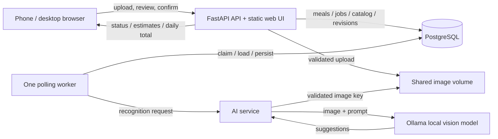
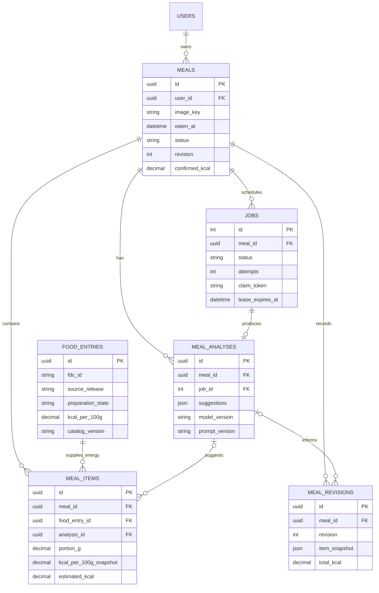

# Architecture Proposal — Photo-assisted Calorie Tracking

**Status:** Week 4 design proposal. Meal-domain components and contracts are planned unless explicitly identified as starter behavior.

## 1. Problem, user, and bounded outcome

Our primary user wants to record everyday meal calories but finds repeated food search and manual entry inconvenient. A photo suggests food identities; the user corrects identities and enters portion weights; a versioned nutrition catalog supplies energy values; application code calculates calories and records the meal.

The first delivery is a responsive browser app usable from a phone. One meal accepts one JPEG or PNG. The initial catalog targets 20 reviewed food entries, including preparation states, for simple meals with one to five visible components. It is not a comprehensive restaurant-food recognizer. Unsupported foods remain unresolved until the user chooses a supported approximation or explicitly removes an incorrect suggestion.

The MVP does not require body measurements or personalized diet plans. The core loop is **photo → suggestions → user review → calorie estimate → meal history → daily total**. Estimates depend on selected foods and entered weights; a single photo does not establish hidden ingredients or precise nutrition.

## 2. Primary and exception workflows

1. User takes/selects a photo and chooses the meal's eating time.
2. API validates the file, writes an image, and transactionally creates a meal and recognition job. It returns `202` with IDs.
3. Browser polls job state every two seconds during processing.
4. Worker claims the job and asks the AI service to identify visible foods.
5. AI service validates output; worker maps exact supported aliases and persists original suggestions and model metadata.
6. Meal becomes `needs_review`. User corrects food/preparation choices, adds ingredients, removes wrong suggestions, and enters edible grams. Each mapped item shows its nutrition source and estimated kcal.
7. User confirms a complete nonempty list. API validates and recalculates calories, stores current items and an immutable revision, and changes the meal to `confirmed` in one transaction.
8. History and daily summary include confirmed meals; drafts and failures are listed separately rather than counted as zero-calorie meals.

Exception paths:

- Blurry/non-food image or uncertain identity: show an explanation and require review; offer a new upload or manual selection.
- Unsupported food: keep mapping unresolved; do not invent nutrition values. Confirmation requires a supported entry or explicit removal of an incorrect suggestion. A chosen approximation is labeled.
- Unknown weight: require grams before confirmation. Automatic weight inference is not required.
- Recognition failure: preserve the error; offer manual food entry on the same meal or one explicit new recognition job.
- Confirmed edit: replace the full list with a revision check, append a revision, and recompute totals from current confirmed meals.
- Late analysis after manual confirmation: preserve analysis but do not overwrite confirmed items or state.

Manual input protects recording when AI fails. It does not count as a real-model recognition success.

## 3. Starter evidence and adaptation

| Existing evidence | Reuse | Required change |
|---|---|---|
| `services/api/app/main.py` | FastAPI, persistence, retrieval | Meal/review/history/summary APIs and browser UI |
| `services/common/models.py` | SQLAlchemy and job states | Meal entities and constraints |
| `services/worker/app/main.py` | Polling and separate AI HTTP call | Safe claim, retry/recovery, meal analysis |
| `services/ai/app/main.py` | Service boundary, health, metrics | Vision-model adapter replacing keyword triage |
| `alembic/` | Migrations | Meal schema migration without destructive reset |
| `compose.yaml` | API/AI/worker/database | Image volume and configured Ollama connection |
| `tests/` | Unit/integration/smoke structure | Calculation, confirmation, worker and model checks |

Current worker behavior: select then update without an exclusive row claim; request timeout; no automatic retry or expired-claim recovery. Current AI behavior: deterministic keyword classification. The proposed meal workflow is not implemented by that baseline.

## 4. Components and boundaries



| Component | Responsibility |
|---|---|
| Browser | Upload, status/errors, food/grams review, confirmation, history and totals |
| API | Validation, image persistence, jobs, catalog lookup, deterministic calories and revisions |
| PostgreSQL | Durable state and catalog; no image bytes |
| Worker | Recognition jobs, attempts, retries and result persistence |
| AI service | Resolve validated image key, call model, validate structured suggestions |
| Ollama | Proposed local inference; download model before demonstration |
| Image volume | API writes; AI reads; survives restart |

Use simple HTML/CSS/JavaScript served under `/app`; no extra frontend service/build is needed for the first workflow. PostgreSQL is the job queue; Redis/Celery and object storage are outside the base plan.

Start with a private, single-demo-user installation bound to the demo machine. Resolve identity server-side rather than trusting an arbitrary client `user_id`. Multiuser authentication is outside the first slice; public multiuser deployment requires authentication and ownership checks before release.

### Image persistence

Planned limits: one JPEG/PNG, at most 10 MiB and 20 megapixels. Validate decoded content, not only filename/MIME. Re-encode to remove metadata; resize model input to a maximum 1280-pixel long edge. Add an image decoder and multipart support when implementing; current dependencies do not include them.

Generated keys such as `meals/<uuid>.jpg` replace client filenames. No client-supplied filesystem path or remote URL is accepted. Mount API storage read/write and AI storage read-only. AI resolves keys inside its configured storage root. Remove new files on database failure; restart cleanup removes old unreferenced uploads. Missing images fail visibly. Normal Compose restart preserves files and rows.

## 5. Nutrition data and calorie calculation

Use a curated subset of **USDA FoodData Central SR Legacy, April 2018**, from the official [downloads](https://fdc.nal.usda.gov/download-datasets/) and [data documentation](https://fdc.nal.usda.gov/data-documentation/). Import about 20 entries in Week 5 for supported foods such as cooked rice, eggs, chicken, vegetables, fruit and oil; exact records must be selected and checked before claiming coverage.

Record source FDC ID, release, source description, preparation state, energy unit and kcal per 100 g. Reject missing energy and non-kcal fields unless converted and verified. Retain the seed, source URL, retrieval date, checksum and selection notes. Verify every selected energy value and raw/cooked state against the source. Runtime needs no live nutrition API or subscription.

Aliases are a small reviewed list, not an AI nutrition database. A match points to a specific prepared/raw source entry. Model output cannot create entries or authoritative calorie densities.

```text
item_kcal = edible_portion_g × source_kcal_per_100g / 100
meal_kcal = sum(item_kcal for the confirmed item list)
daily_kcal = sum(current confirmed meal_kcal in the requested local day)
```

Use decimal arithmetic; retain unrounded values and display one decimal place. Server recalculates totals rather than trusting client values. Portions must be positive and at most 5000 g per item; confirmation accepts one to twenty items.

An arithmetic fixture with **synthetic test densities** of 100 and 200 kcal/100 g yields 150 + 100 = 250 kcal for 150 g and 50 g. These are test densities, not actual USDA values.

Unresolved food or missing grams produces an incomplete review estimate, with known subtotal and unresolved count, not a silent zero. Confirmation still produces an estimate because user weights, food matches, oils and recipes have uncertainty.

Initially use `Asia/Hong_Kong` as the user timezone. Store eating time in UTC; convert local-day boundaries to a UTC interval. Do not group by UTC date. Daily responses show confirmed kcal/count and unconfirmed meal count.

## 6. Persistent model and ERD

| Entity | Important fields / purpose |
|---|---|
| `users` | UUID, display name, timezone, timestamps; one seeded demo owner |
| `food_entries` | UUID, FDC ID, release/URL, description, preparation state, aliases JSONB, kcal/100 g NUMERIC, catalog version; immutable |
| `meals` | UUID, user FK, optional image key/hash, UTC eating time, state, input mode, revision number, confirmed kcal NUMERIC, timestamps |
| `jobs` | ID, meal FK, `analyze_meal` type, state, attempts, next-attempt time, claim token/lease, safe error code, processing timestamps |
| `meal_analyses` | UUID, meal FK, unique job FK, original suggestions JSONB, warnings, model tag/digest, prompt version, image hash, duration/time |
| `meal_items` | UUID, meal FK, food-entry FK, optional analysis FK, label, grams, snapshotted density, computed kcal, user note |
| `meal_revisions` | UUID, meal FK, revision, optional analysis FK, full confirmed-item snapshot JSONB, total kcal, input mode, change reason/time |



Constraints and persistence decisions:

- Foreign keys, nonnegative energy, positive grams and status checks.
- Unique `(fdc_id, source_release, catalog_version)`, unique analysis `job_id`, unique `(meal_id, revision)`.
- Jobs indexed by `(status, next_attempt_at, created_at)`; meals by `(user_id, eaten_at)`.
- PostgreSQL partial unique index allows at most one pending/claimed job per meal.
- Images are referenced separately; original suggestions and confirmed revisions are immutable.
- Current items may change on edit; full revisions preserve previous values/reasons. Snapshot nutrition density so later catalog versions do not rewrite history.
- Confirmation locks the meal, checks submitted revision, replaces items, appends a revision and updates kcal atomically. Invalid confirmation saves nothing.
- Add Alembic migrations; do not claim the schema exists or reset starter data to simulate migration.

## 7. API and internal service contract

These are proposed routes. Existing `/cases` routes remain starter behavior until implementation replaces or retires them.

| Method and path | Contract |
|---|---|
| `POST /meals` | Multipart image and offset-aware ISO-8601 `eaten_at`; `202`, meal/job IDs and queued status |
| `GET /meals/{meal_id}` | `200`, state, latest analysis, confirmed items/total, revision; unknown ID `404` |
| `GET /jobs/{job_id}` | `200`, status, attempts, safe error and next retry time |
| `GET /foods?query=...&limit=20` | Search, limit 1–100; source/preparation and kcal/100 g |
| `PUT /meals/{meal_id}/confirmation` | Full items, current revision and reason; `200`, persisted revision and calculated kcal |
| `POST /meals/{meal_id}/retry` | Failed unconfirmed meal only; new job `202`; active/confirmed `409` |
| `GET /meals?date=YYYY-MM-DD&limit=20&offset=0` | Local-day history including drafts/failures; limit 1–100 |
| `GET /daily-summary?date=YYYY-MM-DD` | Date/timezone, confirmed kcal/count and unconfirmed count |
| `GET /health/live`, `GET /health/ready` | Liveness and dependency readiness |

Use `413` for upload size, `415` for unsupported type, `422` for invalid decoded images/dates/foods/weights/empty lists, and `409` for stale revisions. Provider failure becomes job state rather than a hanging upload.

Example confirmation request:

```json
{
  "revision": 0,
  "items": [
    {"food_entry_id": "<catalog UUID>", "portion_g": 150, "note": "user supplied weight"}
  ],
  "change_reason": "Confirmed food and edible portion weight"
}
```

API infers the owner and calculates totals. A failed or processing meal can be manually confirmed through the same contract; `input_mode` records the decision. A repeated request with an old revision returns `409`, without duplicate history.

Internal `POST /analyze-meal` receives `job_id`, `meal_id`, generated `image_key` and prompt version. The AI service returns a validated object:

```json
{
  "foods": [
    {"name": "cooked rice", "preparation": "cooked", "needs_review": true}
  ],
  "warnings": ["Portion weight must be supplied by the user"],
  "model_version": "<recorded model tag and installed digest>",
  "prompt_version": "meal-foods-v1"
}
```

Empty foods with a warning is valid for unreadable/non-food input. Validate counts/types/text lengths; reject malformed output. `needs_review` is uncertainty, not a calibrated probability. All items require confirmation. Fixtures are labeled `fixture`, never real-model recognition.

## 8. Async states, retries, and recovery

| Actor | Transition | Durable evidence |
|---|---|---|
| API | new meal → `queued`; job → `pending` | Image metadata, eating time, IDs, timestamps |
| Worker | job `pending` → `claimed`; meal → `processing` | Attempt, claim token, lease |
| Worker | job → `completed`; meal → `needs_review` | Immutable analysis, model/prompt metadata, end time |
| Worker | transient failure: job → `pending`; meal → `queued` | Error code, attempt logs, next-attempt time |
| Worker | permanent/exhausted failure: job/meal → `failed` | Error code and end time |
| API | review/failed/queued/processing meal → `confirmed` | Validated items, kcal, revision, input mode |
| API | confirmed edit → `confirmed` | New revision and correction reason |
| API | failed unconfirmed meal → `queued` | New job; old failed job retained |

Start with one worker. In a short transaction, select an eligible job with `FOR UPDATE SKIP LOCKED`, assign a fresh claim token and increment attempts, then commit before HTTP inference. Never hold the database transaction during model execution.

Planned defaults: two-second poll, 60-second worker-to-AI request timeout, 50-second AI-to-model timeout, 90-second lease, maximum three attempts per job, and retry delays of two then ten seconds. Week 5 measurements may justify an explicit revision of defaults before API freeze. Reclaimed attempts count toward the same limit.

Retry connection/timeouts and provider `429`/`5xx`. Bad image, missing model and invalid structured output are terminal for that job. Offer manual entry or a new job after fixing the cause; do not indefinitely retry broken configuration.

On each poll, recover expired claims: revoke old token, record `worker_lease_expired`, requeue within the attempt budget, otherwise fail. Publication checks the current token and rejects late results. Analysis and job completion commit together; unique analysis `job_id` prevents duplicate publication.

Lock the meal when publishing analysis. A manually confirmed meal keeps its items/revision/total while the job completes and analysis is preserved. Job failures likewise do not change already confirmed meal state.

## 9. AI feasibility, traceability, and privacy

Base proposal: **Ollama with `qwen2.5vl:3b`** on team-controlled hardware, with a recorded model digest. The [official listing](https://ollama.com/library/qwen2.5vl) identifies it as image-capable; use the [documented vision API](https://docs.ollama.com/capabilities/vision). Availability does not establish our accuracy or hardware suitability.

Use an HTTP adapter, bounded recognition prompt and application schema validation. Do not ask AI to invent calorie densities. Catalog lookup, calculation, ownership and state changes remain application responsibilities.

Week 5 feasibility gate: record machine RAM/processor, runtime/model versions, cold-start behavior, per-image timings and ten consented simple-food outcomes. Target at least eight schema-valid responses within the 50-second model timeout after warmup; manually record visible-food correctness. If it fails, reduce image size/food breadth and repeat on the same set, or evaluate another available local model through the same adapter. A paid provider is an optional team choice, never a hidden dependency.

If no available model works, document the blocker and revise the plan with the instructor before Week 7. Manual entry and fixtures allow engineering progress but cannot satisfy the real AI demonstration.

Persist image hash, job/meal IDs, model tag/digest, prompt version, original validated output, warnings, processing time and confirmed revisions. Do not present model self-reported uncertainty as calibrated confidence.

Use owned/consented demo photos; no body-profile data is needed. Logs contain IDs, status, attempts, error types and durations, not images, full prompts or credentials. Keep demo uploads outside Git and publish only consented assets. Base local inference does not send photos to a hosted provider; document any future change of processing location.

## 10. Milestones and work allocation

These proposed checkpoints follow the repository's Week 5/7/9/11/13 plan; they are not new instructor deadlines.

| Checkpoint | Deliverables | Exit evidence |
|---|---|---|
| Week 5 | Model feasibility; reviewed 20-entry seed; migration; meal upload/read APIs | Hardware/model report; source-checked seed; clean-DB migration; persistent meal and job |
| Week 7 | Browser, real recognition, review, confirmation, daily total | Ten-photo evaluation: at least eight reach suggestions; all ten can reach confirmation with visible fallback |
| Week 9 | Image volume, model setup, seed, repeatable startup | Second member reproduces workflow; records/images survive restart |
| Week 11 | Retry/recovery, revision conflicts, metrics | Injected timeout/restart; no duplicate analysis or overwritten manual input |
| Week 13 | Final workflow, checks, operations guide and demo | Core acceptance cases pass; genuine model demonstration and limitations |

Workstreams: frontend/review UI; API/schema/calculation; AI/catalog/evaluation; worker/deployment/reliability. Assign one primary owner and second reviewer to each before Week 5. Individual assignments need team agreement. Freeze contracts first and integrate upload → job → analysis → confirmation before expanding UI features.

### Acceptance and measurement plan

- **Product KPI:** confirmed-record completion = valid submitted photos reaching persisted confirmation / valid submitted photos. Week 7 target: all ten evaluation photos can be recorded, including labeled manual fallback.
- **AI KPI:** schema-valid real-model suggestions and manually judged visible-food correctness, measured separately from manual success. Target at least eight of ten simple photos reaching suggestions. This is not calorie accuracy.
- **Operations:** attempts, failures/timeouts, upload-to-review and confirmation latency. Initial warm-model p95 upload-to-review target: under 60 seconds; report failures separately. Ten photos give a preliminary result, not a production benchmark.
- **Calculation:** synthetic arithmetic fixtures, invalid/missing grams, density snapshots, ignored client totals, edited totals counted once.
- **Persistence/exceptions:** reload, restart, unknown IDs, bad uploads, unsupported food, malformed model output, failed recognition and late-result/manual-confirmation race.
- **Time/state:** Hong Kong midnight, drafts excluded, revision conflicts, duplicate completion, expired claims and retry exhaustion.
- **Method:** unit tests for calculations/validation, PostgreSQL integration tests for transactions/claims, deployed smoke checks, and separately recorded real-model evaluation.

## 11. Risk register and scope cuts

| Risk / assumption | Mitigation | Fallback or cut |
|---|---|---|
| Photo cannot establish weight/hidden oil | Mandatory grams and ingredient correction | Remove automatic portion suggestions |
| Hardware/model cannot meet latency | Week 5 gate, bounded images, one worker | Narrow inputs; available-model evaluation; instructor review if unresolved |
| Small catalog misses mixed/local dishes | Show preparation/source and unresolved items | Supported demo meals; explicit approximation or manual choice |
| Missing/incorrect nutrition | Check every chosen source value and unit | Drop incomplete entries; no fabricated values |
| Timeout/output error/crash | Bounded retries, leases, validation | Visible failure/manual entry; job evidence retained |
| Duplicate/late result overwrites review | Token, unique result, meal lock, transaction | Reject stale writes; preserve confirmation |
| Lost/exposed uploads | Mounted storage, generated keys, metadata removal, private demo | Document backup/reset; consented data |
| Scope grows | One complete core path first | Cut plans, profiles, predictions, social and advanced dashboards |

Must keep: real recognition, editable identities, user grams, traceable nutrition, deterministic calories, persisted meals, daily total, visible failure handling and deployment evidence.

Cut first: automatic grams, multi-photo meals, macros/charts, native packaging, personalized plans and broad mixed-dish support. If needed, reduce catalog breadth and UI complexity while keeping correction, persistence and genuine AI.

## 12. Week 4 review gates

- Confirm the official selected brief permits this scope; its full text was not provided in this session.
- Team name is `group14`, confirmed by Zhang Boxiang. Confirm scope, available hardware/model and workstream owners.
- Review nutrition/model assumptions; no inference, nutrition import or meal implementation was performed for this documentation revision.
- Complete team verification in the AI Use Statement honestly.
- Commit reviewed artifacts, create/push `w04-proposal`, capture its SHA and complete Canvas.

Supporting records: [Week 4 summary](../submissions/week04/README.md), [AI statement](../submissions/week04/ai-use-statement.md), [Canvas template](../submissions/week04/canvas-submission.txt).
