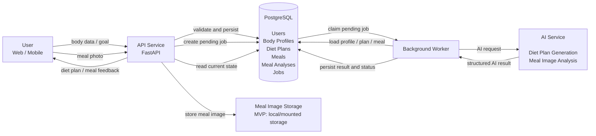
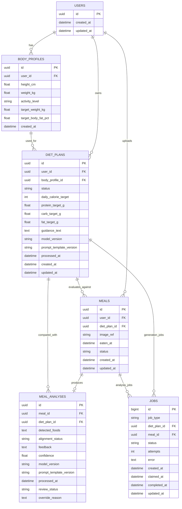

# Architecture Proposal

## 1. Project Overview

### Problem

Users who want to manage their weight or body-fat goals often receive a diet plan but have difficulty evaluating whether their actual daily meals are consistent with that plan.

Our project proposes an AI-enabled diet planning and meal analysis platform. The system first uses user-provided body information and personal goals to generate a personalized diet plan. After the plan is generated, the user can upload a photo of each meal. The platform analyzes the meal image, compares the result with the user's active diet plan, and returns feedback and practical suggestions.

The project focuses on general wellness and dietary guidance. It is not intended to diagnose medical conditions or replace professional medical or dietetic advice.

### Primary User

The primary user is an individual who wants to manage body weight or body-fat goals and needs ongoing assistance in following a dietary plan.

### Core Value

The platform connects two activities that are often separated:

1. generating an initial diet plan; and
2. continuously checking real meals against that plan.

The core product loop is:

`Body Profile → Diet Plan → Meal Photo → AI Analysis → Plan Comparison → Feedback`

---

## 2. Starter Baseline and Proposed Adaptation

The starter repository demonstrates the following engineering pattern:

`API → PostgreSQL → Job → Worker → AI Service → Persisted Result → API Retrieval`

Our proposal will preserve this engineering structure while replacing the generic case-triage domain with a diet-planning and meal-analysis domain.

### Keep from the Starter

- API → database → worker architecture
- PostgreSQL persistence
- asynchronous background job processing
- health-check endpoints
- Alembic migrations
- structured logging
- integration and smoke testing
- explicit job lifecycle states

### Adapt or Replace

- Replace `Case` with domain-specific entities such as `BodyProfile`, `DietPlan`, and `Meal`
- Replace `triage_case` jobs with:
  - `generate_diet_plan`
  - `analyze_meal`
- Replace generic AI triage logic with:
  - diet-plan generation
  - multimodal meal-image analysis
- Adapt tests to verify the new end-to-end workflow

### Add Only if Needed

- diet-plan history/versioning
- human-review workflow
- AI model/prompt version tracking
- additional monitoring of AI latency and failures
- retry policies beyond the starter implementation

---

## 3. Primary User Workflow

The initial product will implement one meaningful end-to-end vertical slice.

1. **User submits body information and a goal.**  
   The user provides basic information such as height, weight, activity level, and a target weight or target body-fat percentage.

2. **API validates the input.**  
   The API checks required fields, validates formats and acceptable ranges, and rejects incomplete or invalid requests.

3. **The system persists the profile and goal.**  
   A `BodyProfile` record is created and linked to the user.

4. **The system creates a diet-plan generation job.**  
   A new `DietPlan` request is created together with a `generate_diet_plan` job whose initial status is `pending`.

5. **The worker generates the diet plan.**  
   The worker claims the job, loads the related body profile, calls the AI-enabled diet-planning function, validates the returned structure, and persists the generated plan.

6. **The user uploads a meal photo.**  
   The API validates the upload, creates a `Meal` record, stores an image reference, links the meal to the active diet plan, and creates an `analyze_meal` job.

7. **The worker analyzes the meal.**  
   The worker claims the meal-analysis job, loads the meal and active diet plan, calls the multimodal AI function, identifies the main foods, and evaluates the meal against the current plan.

8. **The system stores and returns feedback.**  
   A `MealAnalysis` result is persisted with an alignment assessment, confidence information, and feedback. The user retrieves the analysis through the API or application interface.

### Exception Path

If AI processing fails:

`processing → failed → retry / request new image / visible error`

The system should persist the original request and associated records rather than deleting them. The failed job records the error so processing can be retried or investigated.

For poor-quality meal images, the user may be asked to upload another image.

---

## 4. Architecture

### Architecture Principles

The proposal intentionally follows the starter repository's simple architecture:

- the API owns request validation and record creation;
- PostgreSQL stores durable workflow state;
- asynchronous jobs are persisted in the database;
- a worker polls and claims pending jobs;
- the worker performs AI-enabled processing;
- results and failures are written back to PostgreSQL;
- the API exposes the current persisted state to the user.

A separate Redis queue is not required for the MVP.

### Architecture Flow

### Component Responsibilities

#### User Interface

**Responsibility**

- collect body information and target
- display the active diet plan
- upload meal images
- display meal analysis and feedback

**Writes**

- profile inputs
- target information
- meal image

**Reads**

- diet plan
- meal-processing status
- meal-analysis feedback

---

#### API Service

**Responsibility**

- validate requests
- create and retrieve persistent records
- create asynchronous jobs
- expose current workflow state

**Writes**

- users
- body profiles
- diet-plan request records
- meals
- jobs

**Reads**

- diet plans
- meals
- meal analyses
- jobs

The API should not perform long-running AI processing inside the HTTP request cycle.

---

#### PostgreSQL

**Responsibility**

PostgreSQL represents the durable system truth.

It stores:

- user/profile information
- generated diet plans
- meal metadata
- meal-analysis results
- job state
- timestamps
- AI traceability information

Logs explain execution, while database records represent the durable state of the workflow.

---

#### Background Worker

**Responsibility**

- poll for pending jobs
- claim work
- load related database records
- call AI services
- validate AI results
- persist completed or failed state

The worker supports two initial job types:

- `generate_diet_plan`
- `analyze_meal`

---

#### AI Service

The AI layer supports two functions.

##### Diet Plan Generation

Input:

- body-profile reference/data
- user goal

Output:

- daily calorie target where applicable
- high-level macronutrient targets
- general dietary guidance
- structured metadata needed by the application

##### Meal Analysis

Input:

- meal image
- active diet plan

Output:

- identified main foods
- approximate meal characteristics
- alignment assessment
- confidence information
- short feedback and recommendations

The MVP does not assume that a single image can provide exact portion-size or calorie estimation.

---

## 5. Persistent Entities and Schema

The MVP targets six meaningful persistent entities.

### Entity Summary

| Table | Purpose |
|---|---|
| `users` | Stable owner identifier for user data |
| `body_profiles` | Snapshot of body information and goal used for plan generation |
| `diet_plans` | Generated plan and its lifecycle |
| `meals` | Uploaded meal metadata and image reference |
| `meal_analyses` | Persisted AI analysis of a meal |
| `jobs` | Asynchronous processing state |

### Proposed Schema

#### `users`

| Field | Description |
|---|---|
| `id` | Primary key |
| `created_at` | Record creation timestamp |
| `updated_at` | Last update timestamp |

Authentication is not required for the first vertical slice. A stable demo user ID may be used during the MVP.

---

#### `body_profiles`

| Field | Description |
|---|---|
| `id` | Primary key |
| `user_id` | Foreign key → `users.id` |
| `height_cm` | Height |
| `weight_kg` | Current weight |
| `activity_level` | User activity level |
| `target_weight_kg` | Optional target weight |
| `target_body_fat_pct` | Optional body-fat target |
| `created_at` | Profile snapshot timestamp |

A new profile may be created when important user data changes instead of overwriting the historical data used by previous plans.

---

#### `diet_plans`

| Field | Description |
|---|---|
| `id` | Primary key |
| `user_id` | Foreign key → `users.id` |
| `body_profile_id` | Foreign key → `body_profiles.id` |
| `status` | Current plan lifecycle |
| `daily_calorie_target` | Optional high-level target |
| `protein_target_g` | Optional protein target |
| `carb_target_g` | Optional carbohydrate target |
| `fat_target_g` | Optional fat target |
| `guidance_text` | Generated general dietary guidance |
| `model_version` | AI/model identifier |
| `prompt_template_version` | Prompt/template identifier |
| `processed_at` | AI processing timestamp |
| `created_at` | Record creation timestamp |
| `updated_at` | Last update timestamp |

---

#### `meals`

| Field | Description |
|---|---|
| `id` | Primary key |
| `user_id` | Foreign key → `users.id` |
| `diet_plan_id` | Foreign key → `diet_plans.id` |
| `image_ref` | Reference/path to the uploaded image |
| `eaten_at` | Approximate meal time |
| `status` | Meal processing state |
| `created_at` | Record creation timestamp |
| `updated_at` | Last update timestamp |

The database stores an image reference rather than the raw image binary.

---

#### `meal_analyses`

| Field | Description |
|---|---|
| `id` | Primary key |
| `meal_id` | Foreign key → `meals.id`, unique for the MVP |
| `diet_plan_id` | Foreign key → the plan used for comparison |
| `detected_foods` | Structured or textual representation of identified foods |
| `alignment_status` | `aligned`, `partially_aligned`, or `not_aligned` |
| `feedback` | AI-generated feedback |
| `confidence` | AI confidence/uncertainty information if available |
| `model_version` | AI model identifier |
| `prompt_template_version` | Prompt/template identifier |
| `processed_at` | Analysis timestamp |
| `review_status` | Optional human-review state |
| `override_reason` | Optional reviewer explanation |

Storing `diet_plan_id` on the analysis preserves which plan version was used even if the user's active plan later changes.

---

#### `jobs`

| Field | Description |
|---|---|
| `id` | Primary key |
| `job_type` | `generate_diet_plan` or `analyze_meal` |
| `diet_plan_id` | Optional FK → `diet_plans.id` |
| `meal_id` | Optional FK → `meals.id` |
| `status` | Processing lifecycle |
| `attempts` | Processing attempt count |
| `error` | Failure information |
| `created_at` | Job creation time |
| `claimed_at` | Worker claim time |
| `completed_at` | Completion/failure time |
| `updated_at` | Last update time |

For each job, exactly one domain target should normally be present:

- diet-plan job → `diet_plan_id`
- meal-analysis job → `meal_id`

### ER Diagram

---

## 6. State Transitions

### State Definitions

#### Diet Plan

`pending → active`

Failure path:

`pending → failed`

Replacement path:

`active → superseded`

#### Meal

`uploaded → processing → analyzed`

Failure path:

`processing → failed`

#### Job

`pending → claimed → completed`

Failure path:

`claimed → failed`

### State Transition Responsibility Table

| Actor | Record | Current State | Allowed Transition | Evidence Persisted |
|---|---|---|---|---|
| API | `DietPlan` | new request | `→ pending` | plan ID, profile reference, timestamps, job |
| Worker | `Job` | `pending` | `pending → claimed` | `claimed_at`, incremented `attempts` |
| Worker | `DietPlan` | `pending` | `pending → active` | generated plan, AI metadata, `processed_at` |
| Worker | `DietPlan` | `pending` | `pending → failed` | related job error and timestamps |
| API | `Meal` | new upload | `→ uploaded` | image reference, plan ID, timestamp |
| Worker | `Meal` | `uploaded` | `uploaded → processing` | current processing state |
| Worker | `Job` | `pending` | `pending → claimed` | claim timestamp and attempts |
| Worker | `MealAnalysis` | processing | `→ completed` | foods, alignment, confidence, feedback |
| Worker | `Meal` | `processing` | `processing → analyzed` | final meal status |
| Worker | `Meal` | `processing` | `processing → failed` | failed status and job error |
| Worker | `Job` | `claimed` | `claimed → completed` | `completed_at`, cleared error |
| Worker | `Job` | `claimed` | `claimed → failed` | error and `completed_at` |
| API / user action | `DietPlan` | `active` | `active → superseded` | old plan retained and new plan referenced |

State changes are controlled by the component responsible for that workflow stage. API code creates records and asynchronous work. Workers own AI-processing state transitions and result persistence.

---

## 7. Worker and AI Processing Plan

### Job Type: `generate_diet_plan`

1. API validates the body profile and goal.
2. API creates a pending diet-plan record.
3. API creates a pending `generate_diet_plan` job.
4. Worker claims the job.
5. Worker loads the referenced body profile.
6. Worker calls the AI diet-planning function.
7. Worker validates the returned structured response.
8. Worker writes the generated plan to PostgreSQL.
9. Worker marks the plan `active`.
10. Worker marks the job `completed`.

Failure results in:

- job → `failed`
- diet plan → `failed`
- error persisted for diagnosis

### Job Type: `analyze_meal`

1. API receives a meal upload.
2. API stores the image reference.
3. API creates a `Meal` record.
4. API creates a pending `analyze_meal` job.
5. Worker claims the job.
6. Worker loads the meal and associated diet plan.
7. Worker calls the multimodal AI service.
8. Worker validates the AI response.
9. Worker creates the `MealAnalysis`.
10. Worker marks the meal `analyzed`.
11. Worker marks the job `completed`.

---

## 8. AI Traceability and Human Review

The platform should preserve enough information to explain how an AI result was produced.

### Traceability Information

For diet-plan generation:

- `body_profile_id`
- model version
- prompt/template version
- generated plan
- processing timestamp
- job ID

For meal analysis:

- `meal_id`
- `diet_plan_id`
- image reference
- model version
- prompt/template version
- detected foods
- alignment result
- confidence/uncertainty
- feedback
- processing timestamp
- job ID

Input references should be preserved rather than relying only on the user's latest profile or latest diet plan.

This allows the system to answer:

- Which profile was used?
- Which diet-plan version was used?
- Which model produced the result?
- When was the result produced?
- What did the AI originally return?
- Was the result later reviewed or overridden?

### Human Review

Human review is not required for every result in the MVP.

Possible review conditions include:

- low-confidence AI output
- unclear meal image
- invalid or incomplete AI response
- result inconsistent with required schema
- future cases requiring additional judgment

Possible actions:

| Situation | Action |
|---|---|
| acceptable result | persist and return |
| unclear photo | ask user for another image |
| low confidence | label result as uncertain / optionally `needs_review` |
| invalid AI output | fail or retry the job |
| AI service unavailable | record failure and allow retry |
| reviewer override | preserve original AI output and record reason |

The exact threshold for low confidence will be determined during implementation and testing.

---

## 9. Privacy and Logging

The project processes potentially sensitive body information and user-uploaded meal images.

Application logs should avoid duplicating raw personal data.

Preferred logging identifiers include:

- `user_id`
- `diet_plan_id`
- `meal_id`
- `job_id`
- job type
- status
- processing duration
- error category
- model version where appropriate

The following should not be written directly into normal application logs:

- complete body-profile contents
- authentication credentials
- secrets or API tokens
- raw meal-image contents
- complete prompts containing personal user data

The database should store only information required for the product workflow.

---

## 10. API Draft

The exact contract will be finalized in Week 5.

Initial endpoints may include:

| Method | Endpoint | Purpose |
|---|---|---|
| `POST` | `/users/{user_id}/profiles` | create body-profile snapshot |
| `GET` | `/users/{user_id}/profiles/latest` | retrieve current profile |
| `POST` | `/diet-plans` | request diet-plan generation |
| `GET` | `/diet-plans/{plan_id}` | retrieve plan/status |
| `POST` | `/meals` | upload/create meal |
| `GET` | `/meals/{meal_id}` | retrieve meal/status |
| `GET` | `/meals/{meal_id}/analysis` | retrieve analysis |
| `GET` | `/jobs/{job_id}` | retrieve processing job state |
| `GET` | `/health/live` | liveness check |
| `GET` | `/health/ready` | readiness check |

Authentication/authorization is outside the first vertical-slice scope and may initially use a stable demo user.

---

## 11. Failure Behaviour

The architecture treats failures as persistent workflow states rather than only log events.

### AI Service Failure

- worker catches the exception
- job is marked `failed`
- error is persisted
- related plan or meal is marked failed when appropriate
- user receives a visible processing failure
- retry may be allowed

### Invalid AI Response

- structured response is validated
- invalid responses are not silently treated as successful
- the job may fail or retry according to implementation policy

### Poor Meal Image

- AI may return insufficient confidence
- result is not presented as certain
- user may be prompted to upload a clearer image

---

## 12. Milestone Plan

| Milestone | Minimum Credible Outcome |
|---|---|
| **Week 5** | Final API contract, database schema, migrations, and first API → PostgreSQL persistence path |
| **Week 7** | Complete end-to-end vertical slice: profile → diet plan → meal upload → AI meal analysis → feedback retrieval |
| **Week 9** | Reproducible Docker deployment with documented setup |
| **Week 11** | Improved reliability, failure handling, structured logging, observability, and basic performance measurement |
| **Week 12** | Stable tested workflow, final documentation, and reproducible demonstration |

### Week 7 Success Criterion

The minimum successful vertical slice is:

`Profile → Diet Plan → Meal Photo → AI Analysis → Plan Comparison → Persisted Feedback`

Optional product features are secondary until this workflow is stable.

---

## 13. Risk Register

| Risk | Impact | Mitigation |
|---|---|---|
| Food-recognition errors | incorrect meal feedback | expose uncertainty and allow re-upload |
| Portion estimation from one image | inaccurate nutritional estimates | treat estimates as approximate; prioritize qualitative alignment |
| Diet-plan quality | inappropriate recommendations | keep scope to general wellness, validate inputs, avoid diagnosis |
| Sensitive personal data | privacy/security risk | minimize stored data and avoid personal data in logs |
| External AI failure | workflow interruption | asynchronous jobs, failure states, timeout handling, retry |
| Low-confidence AI result | unreliable feedback | uncertainty/review path |
| Non-deterministic AI output | unstable automated tests | test structure, state, schema, and allowed categories rather than exact wording |
| Excessive project scope | core flow not finished | prioritize one vertical slice and cut optional features |
| Image storage complexity | deployment/storage overhead | store image reference instead of binary in PostgreSQL |
| Schema evolution | existing-data incompatibility | use Alembic migrations and defaults/backfills |

---

## 14. Scope Control

### Must-Have MVP

The following functionality defines the project:

- body-profile and goal input
- persistent body-profile data
- diet-plan generation
- persisted diet plan
- meal-photo upload
- asynchronous jobs
- AI meal analysis
- comparison against the active diet plan
- persisted feedback
- basic failure handling
- result/status retrieval

### First Scope Cuts

If time is limited, the following features will be removed before the core vertical slice:

1. exact portion-size estimation
2. precise calorie estimation from images
3. advanced dashboard and visualization
4. long-term weight/body-fat prediction
5. full human nutritionist review workflow
6. push notifications and reminders
7. social/community features
8. shopping-list generation
9. recipe recommendation
10. advanced multi-model routing

### Further Simplification

If additional scope reduction is necessary:

- the diet plan may use high-level targets and textual guidance;
- meal analysis may use only:
  - `aligned`
  - `partially_aligned`
  - `not_aligned`
- feedback may be a short textual recommendation rather than a detailed nutrient breakdown.

---

## 15. Open Questions

The following design decisions will be validated during implementation:

1. Which AI/model provider will be used for diet-plan generation?
2. Which multimodal model will be used for meal-image analysis?
3. What confidence threshold, if any, should trigger an uncertain/review state?
4. How should meal images be stored in the final deployment?
5. How much nutritional detail can be estimated reliably from one image?
6. Should diet-plan versioning be fully implemented in the MVP or only preserve superseded plans?
7. What retry policy is appropriate for transient AI-service failures?
8. Which profile fields are necessary for the MVP and which can be removed?

---

## 16. Current Scope Boundary

The project aims to demonstrate a coherent and buildable AI engineering workflow rather than a complete commercial nutrition product.

The semester project prioritizes:

- persistent system state
- explicit data relationships
- controlled state transitions
- asynchronous worker processing
- AI integration
- traceable results
- failure handling
- reproducible deployment
- testing and observability

Features that do not directly support the main end-to-end workflow will be deferred.