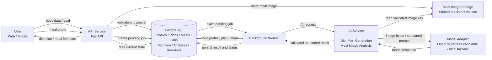

# Architecture Proposal

Team: **group14**. Status: Week 4 proposal; meal-domain features and provider/data integrations below are planned, not implemented.

## 1. Project Overview

### Problem

Users who want to manage their weight or body-fat goals often receive a diet plan but have difficulty evaluating whether their actual daily meals are consistent with that plan.

Our project proposes an AI-enabled diet planning and meal analysis platform. The system first uses user-provided body information and personal goals to generate a personalized diet plan. After the plan is generated, the user can upload a photo of each meal. The platform analyzes the meal image, compares the result with the user's active diet plan, and returns estimated calories/macronutrients, an explainable plan comparison, and practical suggestions. Food identity and quantities can be corrected by the user before results are confirmed.

The project focuses on general wellness and dietary guidance. It is not intended to diagnose medical conditions or replace professional medical or dietetic advice.

### Primary User

The primary user is an individual who wants to manage body weight or body-fat goals and needs ongoing assistance in following a dietary plan.

### Core Value

The platform connects two activities that are often separated:

1. generating an initial diet plan; and
2. continuously checking real meals against that plan.

The core product loop is:

`Body Profile → Diet Plan → Meal Photo → AI Analysis → Plan Comparison → Feedback`

---

## 2. Starter Baseline and Proposed Adaptation

The starter repository demonstrates the following engineering pattern:

`API → PostgreSQL → Job → Worker → AI Service → Persisted Result → API Retrieval`

Our proposal will preserve this engineering structure while replacing the generic case-triage domain with a diet-planning and meal-analysis domain.

### Keep from the Starter

- API → database → worker architecture
- PostgreSQL persistence
- asynchronous background job processing
- health-check endpoints
- Alembic migrations
- structured logging
- integration and smoke testing
- explicit job lifecycle states

### Adapt or Replace

- Replace `Case` with domain-specific entities such as `BodyProfile`, `DietPlan`, and `Meal`
- Replace `triage_case` jobs with:
  - `generate_diet_plan`
  - `analyze_meal`
- Replace generic AI triage logic with:
  - diet-plan generation
  - multimodal meal-image analysis
- Adapt tests to verify the new end-to-end workflow

### Add Only if Needed

- diet-plan history/versioning
- nutritionist-review workflow beyond ordinary user confirmation
- optional model fine-tuning after the baseline is evaluated
- advanced monitoring beyond the core latency/failure measures

User confirmation, model/prompt traceability, bounded retries and recovery of abandoned claims are part of the planned baseline. The existing starter worker does not implement safe concurrent claims, automatic retry or claim recovery; its AI service is a keyword classifier, not a vision model.

---

## 3. Primary User Workflow

The initial product preserves the team's diet-planning and meal-analysis vertical slice:

`Body Profile → Diet Plan → Meal Photo + User Quantities → AI Analysis → User Confirmation → Plan Comparison → Persisted Feedback`

1. **Profile and goal.** The API validates and persists a body-profile snapshot. Course demos use synthetic profiles; at least one goal is required. The team will record any additional inputs required by its selected target-generation method instead of assuming the current fields support every method.
2. **Plan request.** The API creates a pending diet plan and `generate_diet_plan` job in one transaction and returns IDs with `202`.
3. **Plan generation.** The worker validates structured AI targets/guidance and meal-budget fractions, then activates the plan. The previous active plan is superseded only after successful generation. A failed replacement leaves the old plan usable.
4. **Meal upload.** The user supplies a photo, eating time, meal slot, and optional quantities, such as `150 g cooked beef` or `2 large eggs`. The API stores a generated image reference, binds the meal to the selected active plan, and creates an `analyze_meal` job transactionally.
5. **Recognition and interpretation.** The AI service reads the shared image and uses a multimodal model to propose food identities/preparation states and interpret quantity notes. Missing/ambiguous quantities and catalog matches remain unresolved.
6. **Grounded analysis.** The worker maps foods to reviewed nutrition entries, converts supported count units to edible grams, and calculates calories/macronutrients in application code. For a complete draft, it compares against the plan's meal budget and requests AI feedback grounded in those computed values. Missing inputs produce review questions rather than invented values.
7. **User confirmation.** The browser displays editable foods, preparation, quantities, conversion assumptions, sources and estimates. The user confirms/corrects them. The API recalculates, stores an immutable confirmed revision, and marks the meal `analyzed`; feedback for edited values uses the same deterministic comparison and a template so stale AI prose is not presented as current analysis.
8. **Retrieval.** The user retrieves confirmed results, revision history and daily totals against the referenced plan. Historical meals keep their original plan and nutrition snapshots.

### Exception and human-input paths

- Unclear/non-food image: preserve warnings and offer re-upload or manual entry.
- Unsupported food, unspecified egg size, unknown grams or cooking state: require correction; never silently assign zero calories.
- Provider failure: show the persisted failure; permit an explicit new job or manual catalog-backed entry. Manual entry does not count as AI recognition success.
- Correction: save the original AI output separately from the corrected item snapshot and reason. Ordinary user confirmation is MVP; professional nutritionist review is optional.
- Manual confirmation while a job is pending/processing: preserve the confirmed meal. Late job completion/failure cannot overwrite that revision.
- No active plan: return a clear conflict and direct the user to finish plan generation; the meal is not silently evaluated against a missing plan.

---

## 4. Architecture

### Architecture Principles

The proposal intentionally follows the starter repository's simple architecture:

- the API owns request validation and record creation;
- PostgreSQL stores durable workflow state;
- asynchronous jobs are persisted in the database;
- a worker polls and claims pending jobs;
- the worker performs AI-enabled processing;
- results and failures are written back to PostgreSQL;
- the API exposes the current persisted state to the user.

A separate Redis queue is not required for the MVP.

### Architecture Flow

### Component Responsibilities

#### User Interface

**Responsibility**

- collect body information and target
- display the active diet plan
- upload meal images
- display meal analysis, editable food/quantity inputs, source assumptions and feedback
- confirm corrections and show meal history/daily totals

The MVP uses a responsive browser interface; native mobile packaging is optional.

**Writes**

- profile inputs
- target information
- meal image

**Reads**

- diet plan
- meal-processing status
- meal-analysis feedback

---

#### API Service

**Responsibility**

- validate requests
- create and retrieve persistent records
- create asynchronous jobs
- expose current workflow state

**Writes**

- users
- body profiles
- diet-plan request records
- meals
- jobs

**Reads**

- diet plans
- meals
- meal analyses
- jobs
- nutrition foods/portion conversions and confirmed revisions

The API owns deterministic recalculation and confirmation transactions. It should not perform long-running AI processing inside the HTTP request cycle.

---

#### PostgreSQL

**Responsibility**

PostgreSQL represents the durable system truth.

It stores:

- user/profile information
- generated diet plans
- meal metadata
- meal-analysis results
- job state
- timestamps
- AI traceability information

Logs explain execution, while database records represent the durable state of the workflow.

---

#### Background Worker

**Responsibility**

- poll for pending jobs
- claim work
- load related database records
- call AI services
- validate AI results
- persist completed or failed state

The worker supports two initial job types:

- `generate_diet_plan`
- `analyze_meal`

---

#### AI Service

The AI layer supports two functions.

##### Diet Plan Generation

Input:

- body-profile reference/data
- user goal

Output:

- daily calorie target where applicable
- high-level macronutrient targets
- general dietary guidance
- structured metadata needed by the application

##### Meal Analysis

Input: shared image reference, bound plan snapshot, user food/quantity notes and prompt version. The service resolves the image and calls a multimodal provider; it does not pass a container-local path to a hosted model.

Output: structured food/preparation/quantity suggestions, unresolved questions, model/provider metadata and uncertainty reasons. The worker uses database-backed nutrition values for deterministic totals and alignment; a subsequent text call can explain a complete computed draft. Every model call is recorded. Edited confirmed values receive freshly computed/template feedback.

Open nutrition data is imported into PostgreSQL; model weights belong in a model runtime, not a database table. The team intends to evaluate open food-recognition/nutrition-estimation models and undertake a bounded fine-tuning experiment if labeled data and compute are available. Training is a separate milestone after the baseline, not a prerequisite for the first end-to-end slice. See [nutrition and model plan](nutrition-model-plan.md).

The MVP aims to improve estimates through user quantities, source-backed lookup and evaluation. It does not promise exact food energy or accurate photo-only portion inference.

---

## 5. Persistent Entities and Schema

Retain the six original workflow entities and add four supporting entities for nutrition lookup, quantity conversion and user corrections. All schema changes require Alembic migrations.

### Entity Summary

| Table | Purpose |
|---|---|
| `users` | Stable owner identifier for user data |
| `body_profiles` | Snapshot of body information and goal used for plan generation |
| `diet_plans` | Generated plan and its lifecycle |
| `meals` | Uploaded meal metadata and image reference |
| `meal_analyses` | Persisted AI analysis of a meal |
| `jobs` | Asynchronous processing state |
| `nutrition_foods` | Versioned energy/macronutrient values and preparation state |
| `food_portions` | Source-backed count-to-edible-grams conversions |
| `meal_items` | Current confirmed foods, quantities and density snapshots |
| `meal_revisions` | Immutable confirmed item/totals/comparison snapshots |

### Proposed Schema

#### `users`

| Field | Description |
|---|---|
| `id` | Primary key |
| `created_at` | Record creation timestamp |
| `updated_at` | Last update timestamp |
| `timezone` | Initial value `Asia/Hong_Kong` for local-day history |

Authentication is not required for the first vertical slice. A stable demo user ID may be used during the MVP.

---

#### `body_profiles`

| Field | Description |
|---|---|
| `id` | Primary key |
| `user_id` | Foreign key → `users.id` |
| `height_cm` | Height |
| `weight_kg` | Current weight |
| `activity_level` | User activity level |
| `target_weight_kg` | Optional target weight |
| `target_body_fat_pct` | Optional body-fat target |
| `created_at` | Profile snapshot timestamp |

A new profile may be created when important user data changes instead of overwriting the historical data used by previous plans.

---

#### `diet_plans`

| Field | Description |
|---|---|
| `id` | Primary key |
| `user_id` | Foreign key → `users.id` |
| `body_profile_id` | Foreign key → `body_profiles.id` |
| `status` | Current plan lifecycle |
| `daily_calorie_target` | Required positive high-level target for the proposed comparison |
| `protein_target_g` | Optional protein target |
| `carb_target_g` | Optional carbohydrate target |
| `fat_target_g` | Optional fat target |
| `guidance_text` | Generated general dietary guidance |
| `meal_budget_fractions` | JSONB: breakfast/lunch/dinner/snack fractions, positive and summing to 1 |
| `comparison_rule_version` | Version of the application comparison rule |
| `generated_by_job_id` | Nullable unique FK → successful generation job, null while pending |
| `original_ai_output` | Validated original structured model response |
| `provider_metadata` | Provider/model/request IDs, call count and processing duration |
| `model_version` | AI/model identifier |
| `prompt_template_version` | Prompt/template identifier |
| `processed_at` | AI processing timestamp |
| `created_at` | Record creation timestamp |
| `updated_at` | Last update timestamp |

---

#### `meals`

| Field | Description |
|---|---|
| `id` | Primary key |
| `user_id` | Foreign key → `users.id` |
| `diet_plan_id` | Foreign key → `diet_plans.id` |
| `image_ref` | Generated internal image key in the shared volume |
| `image_sha256` / `image_metadata` | Re-encoded input hash, type, bytes and dimensions |
| `eaten_at` | Offset-aware input stored as UTC; days use user timezone |
| `meal_slot` | breakfast/lunch/dinner/snack for a plan budget |
| `quantity_notes` | Original user food/quantity input |
| `input_revision` | Incremented on input change; jobs bind to a snapshot |
| `confirmed_revision` | Current confirmed revision number, initially 0 |
| `confirmed_totals` | JSONB energy/macros, null until confirmed |
| `status` | Meal processing state |
| `created_at` | Record creation timestamp |
| `updated_at` | Last update timestamp |

The database stores an image reference rather than the raw image binary.

---

#### `meal_analyses`

| Field | Description |
|---|---|
| `id` | Primary key |
| `meal_id` | FK → `meals.id`; multiple analyses with immutable original output permitted |
| `job_id` | Unique FK → `jobs.id`; one published analysis per job |
| `diet_plan_id` | Foreign key → the plan used for comparison |
| `detected_foods` | JSONB original structured food/quantity suggestions |
| `original_ai_output` | Validated immutable model output, questions and warnings |
| `draft_totals` | JSONB computed values; null/incomplete if quantities are unresolved |
| `calculation_version` | Nutrition calculation version |
| `input_revision` | Revision of input snapshot analyzed |
| `provider_metadata` | Provider/model IDs, request IDs for each call, latency and prompt versions |
| `alignment_status` | Nullable draft label; absent when inputs are unresolved |
| `feedback` | AI-generated feedback |
| `confidence` | Optional model-reported score, not assumed calibrated |
| `uncertainty_reasons` | Missing quantity, ambiguous identity, approximation or missing nutrients |
| `model_version` | AI model identifier |
| `prompt_template_version` | Prompt/template identifier |
| `processed_at` | Analysis timestamp |
| `review_status` | Draft review state: pending/confirmed; original output stays immutable |

Corrections/reasons live in `meal_revisions`, rather than overwriting the original analysis. `MealAnalysis` has no processing lifecycle: it is created only for validated successful results. Processing state belongs to `Job` and `Meal`.

Storing `diet_plan_id` on the analysis preserves which plan version was used even if the user's active plan later changes.

---

#### `jobs`

| Field | Description |
|---|---|
| `id` | Primary key |
| `job_type` | `generate_diet_plan` or `analyze_meal` |
| `diet_plan_id` | Optional FK → `diet_plans.id` |
| `meal_id` | Optional FK → `meals.id` |
| `status` | Processing lifecycle |
| `attempts` | Processing attempt count |
| `error` | Sanitized failure information; no prompts, keys or body details |
| `error_code` | Stable error category exposed to the browser |
| `next_attempt_at` | Earliest automatic retry time |
| `claim_token` | Fresh token per attempt; prevents stale publication |
| `lease_expires_at` | Expired claimed-job recovery time |
| `input_revision` | Meal input revision captured at creation, null for plan jobs |
| `input_snapshot` | Immutable validated input/plan references for reproducible processing |
| `created_at` | Job creation time |
| `claimed_at` | Worker claim time |
| `completed_at` | Completion/failure time |
| `updated_at` | Last update time |

For each job, exactly one domain target must be present, enforced by a CHECK constraint consistent with `job_type`:

- diet-plan job → `diet_plan_id`
- meal-analysis job → `meal_id`

### Supporting entities and persistence constraints

| Entity | Key fields and constraints |
|---|---|
| `nutrition_foods` | UUID; source record ID, release, URL/checksum, food/preparation/aliases; kcal/protein/carbs/fat per 100 g as NUMERIC; missing nutrients nullable; unique source/release/catalog version |
| `food_portions` | UUID; nutrition-food FK; unit/size/preparation label; positive edible grams per unit; source/version; unique food/unit/size/catalog version |
| `meal_items` | UUID; meal FK, nutrition-food FK, optional portion FK; original quantity/unit; normalized grams; immutable density/source snapshot for the current confirmed revision; kcal/macros NUMERIC |
| `meal_revisions` | UUID; meal FK; unique `(meal_id, revision)`; optional source-analysis FK; full confirmed items/totals/assumptions/plan-budget/rule snapshot JSONB; reason, input mode, time |

- Enforce at most one active diet plan per user with a partial unique index. Activation and superseding the previous plan commit atomically. All linked profiles/plans/meals must belong to the same owner.
- A plan's target snapshot is immutable after activation. A replacement creates a new plan; old plans/results remain referenced by historical meals.
- Allow multiple analyses for audit/retry, but enforce unique result `job_id` and at most one pending/claimed analysis job per meal.
- Current items change only in a confirmation transaction; full immutable revisions preserve earlier results. Lock/check the submitted revision to prevent stale edits.
- Snapshot source density and count conversion so later catalog edits do not rewrite calories. Positive grams/counts and nonnegative known nutrient values are constrained; missing data is never a zero.
- API creates the domain record and job together. Worker publishes analysis/domain/job outcome together. Invalid writes roll back.
- Index pending work by `(status, next_attempt_at, created_at)` and meal history by `(user_id, eaten_at)`; use foreign keys for all relationships.

### ER Diagram

```mermaid
erDiagram
    USERS ||--o{ BODY_PROFILES : has
    USERS ||--o{ DIET_PLANS : owns
    USERS ||--o{ MEALS : uploads

    BODY_PROFILES ||--o{ DIET_PLANS : used_for
    DIET_PLANS ||--o{ MEALS : evaluates_against

    MEALS ||--o{ MEAL_ANALYSES : produces
    JOBS ||--o| MEAL_ANALYSES : publishes
    MEALS ||--o{ MEAL_ITEMS : contains
    NUTRITION_FOODS ||--o{ MEAL_ITEMS : supplies
    NUTRITION_FOODS ||--o{ FOOD_PORTIONS : converts
    FOOD_PORTIONS o|--o{ MEAL_ITEMS : normalizes
    MEALS ||--o{ MEAL_REVISIONS : records
    MEAL_ANALYSES o|--o{ MEAL_REVISIONS : informs
    DIET_PLANS ||--o{ MEAL_ANALYSES : compared_with

    DIET_PLANS o|--o{ JOBS : generation_jobs
    MEALS o|--o{ JOBS : analysis_jobs

    USERS {
        uuid id PK
        datetime created_at
        datetime updated_at
        string timezone
    }

    BODY_PROFILES {
        uuid id PK
        uuid user_id FK
        float height_cm
        float weight_kg
        string activity_level
        float target_weight_kg
        float target_body_fat_pct
        datetime created_at
    }

    DIET_PLANS {
        uuid id PK
        uuid user_id FK
        uuid body_profile_id FK
        string status
        int daily_calorie_target
        float protein_target_g
        float carb_target_g
        float fat_target_g
        text guidance_text
        json meal_budget_fractions
        string comparison_rule_version
        bigint generated_by_job_id FK
        json original_ai_output
        string model_version
        string prompt_template_version
        datetime processed_at
        datetime created_at
        datetime updated_at
    }

    MEALS {
        uuid id PK
        uuid user_id FK
        uuid diet_plan_id FK
        string image_ref
        string image_sha256
        datetime eaten_at
        string meal_slot
        int input_revision
        int confirmed_revision
        json confirmed_totals
        string status
        datetime created_at
        datetime updated_at
    }

    MEAL_ANALYSES {
        uuid id PK
        uuid meal_id FK
        uuid diet_plan_id FK
        bigint job_id FK
        json original_ai_output
        json draft_totals
        json detected_foods
        string alignment_status
        text feedback
        float confidence
        string model_version
        string prompt_template_version
        datetime processed_at
        string review_status
    }

    JOBS {
        bigint id PK
        string job_type
        uuid diet_plan_id FK
        uuid meal_id FK
        string status
        int attempts
        text error
        datetime created_at
        datetime claimed_at
        datetime completed_at
        datetime updated_at
        datetime next_attempt_at
        string claim_token
        datetime lease_expires_at
        int input_revision
        json input_snapshot
    }
    NUTRITION_FOODS {
        uuid id PK
        string source_record_id
        string preparation_state
        decimal kcal_per_100g
        decimal protein_per_100g
        decimal carbs_per_100g
        decimal fat_per_100g
        string catalog_version
    }
    FOOD_PORTIONS {
        uuid id PK
        uuid nutrition_food_id FK
        string unit_size
        decimal edible_grams_per_unit
        string source_version
    }
    MEAL_ITEMS {
        uuid id PK
        uuid meal_id FK
        uuid nutrition_food_id FK
        uuid food_portion_id FK
        decimal quantity
        string unit
        decimal normalized_grams
        json nutrition_snapshot
    }
    MEAL_REVISIONS {
        uuid id PK
        uuid meal_id FK
        uuid source_analysis_id FK
        int revision
        json confirmed_snapshot
        string change_reason
        datetime created_at
    }
```

The two optional job-target relationships are mutually exclusive under the job-type CHECK constraint. Field tables define remaining metadata/constraints; the ERD emphasizes keys and core relationships.

---

## 6. State Transitions

- Diet plan: `pending → active`, `pending → failed`; replacement `active → superseded` only when a new plan activates.
- Meal: `uploaded → processing → needs_review → analyzed`; failure `processing → failed`. `analyzed` means a user-confirmed, recalculated result exists.
- Job: `pending → claimed → completed`; transient failure `claimed → pending` within budget; terminal failure `claimed → failed`.
- Analysis: a successful immutable original-output record, with review state pending/confirmed. It is not a processing job.

| Actor | Transition | Persisted evidence |
|---|---|---|
| API | new plan → pending; generation job → pending | Profile/owner snapshot, IDs and time in one transaction |
| Worker | pending job → claimed | Attempt, claim token, lease and claimed time |
| Worker | pending plan → active; old active → superseded | Validated targets, successful job ID, original AI output and model metadata atomically |
| Worker | generation terminal failure → failed | Job error/end time; old active plan remains usable |
| API | new meal → uploaded; analysis job → pending | Image reference, bound plan/slot, notes/input revision atomically |
| Worker | uploaded meal → processing | Claimed job and input revision |
| Worker | analysis job → completed; meal → needs_review | Original suggestions, source-backed draft, questions and metadata atomically |
| Worker | transient failure → pending / uploaded | Error code, next-attempt time and attempt log |
| Worker | terminal failure → failed | Sanitized error and end time |
| API / user | review/failed/uploaded/processing → analyzed | Confirmed catalog items, recomputed totals/alignment and immutable revision |
| API / user | analyzed → analyzed on edit | New full revision and reason; prior revisions retained |
| API / user | failed unconfirmed meal → uploaded | Explicit new job; failed job remains in history |

Worker publication/failure does not change an already confirmed meal or supersede a newer input revision. A manual result and a late AI result can both remain auditable without competing for current confirmed data.

---

## 7. Worker and AI Processing Plan

### `generate_diet_plan`

API persists profile-linked pending plan and job together. Worker loads the immutable profile snapshot, calls the configured text-capable model, validates targets, unit/range rules and meal-budget fractions, then activates the new plan and supersedes the previous plan in one transaction with completed job state. Terminal failure marks only the requested plan/job failed.

### `analyze_meal`

API persists meal and input snapshot with a job after validated image storage. Worker claims the job, calls the AI service for image/quantity interpretation, resolves catalog references, normalizes supported units, calculates a draft and alignment, and optionally calls the configured model to explain complete computed values. An explanation-only failure retains a valid calculated draft with template feedback and a warning rather than failing recognition. It persists the analysis and completed job, then exposes `needs_review`. Missing quantities/mappings are successful recognition with unresolved review questions, not a fabricated complete estimate.

### Claim, retries and recovery

Start with one worker. A short PostgreSQL transaction claims an eligible job using `FOR UPDATE SKIP LOCKED`, assigns a fresh token/lease and increments attempts; commit before calling AI. Result writes require the current token and input revision. A unique analysis per job and transactional publication prevent duplicate results.

Planned defaults: two-second polling; at most three attempts; five- then fifteen-second backoff for connection/timeouts and provider `5xx`. Honor `Retry-After` for `429` by setting `next_attempt_at`, without holding a transaction or sleeping while claimed. Known daily-quota exhaustion, unavailable model/configuration, invalid input and invalid plan/recognition structured output fail visibly rather than retry indefinitely. A transient failure after recognition may repeat model calls, but cannot create duplicate published analyses.

The total processing deadline is 120 seconds for a meal job that may use two sequential model calls; each provider call is capped at 50 seconds and each internal HTTP call is limited by the remaining deadline. Use a 180-second lease. Lookup and validation consume the same processing budget, so they cannot extend processing indefinitely. Record actual call counts and re-evaluate these defaults using Week 5 measurements; these are proposed settings, not the starter's existing timeout.

On each poll recover expired claims: revoke token, log `claim_expired`, requeue within the same attempt budget or fail. A stalled/terminated model request may still finish remotely; stale publication is rejected. Recheck both token and current input revision inside the final transaction. Failures/results from obsolete inputs do not overwrite current user state.

Manual retry creates a new job ID after the cause is corrected; an active job returns conflict. Confirmed edits use deterministic recalculation and revisions. A new photo creates a new meal record in the MVP; successful meals are not silently overwritten by re-upload.

---

## 8. AI Traceability and Human Review

Preserve profile/plan references, original image key/hash, user notes and input revision, job ID, every provider/model/request ID, prompt version, original validated output, nutrition/conversion versions, comparison-rule version, timestamps and latency. `diet_plans.generated_by_job_id` and `meal_analyses.job_id` establish explicit provenance.

Every meal draft requires ordinary user confirmation. The user corrects food/preparation, grams or count/size, missing ingredients and cooking oil; the system displays source-backed conversions and unresolved questions. Missing food/quantity/nutrients prevents a complete confirmed comparison. User quantities take precedence over model estimates after validation.

| Situation | MVP response |
|---|---|
| Complete recognition | Editable sourced draft, then user confirmation |
| Ambiguous food/quantity/preparation | `needs_review` with specific questions; no asserted complete nutrition |
| Non-food/unclear photo | Warning, new upload or manual catalog selection |
| Invalid output/provider failure | Persist failed job, visible error, explicit retry/manual path |
| Corrected or manual result | Recalculate and append a revision; keep original AI output |
| Late completion after confirmation | Preserve original output; leave current confirmed result intact |

Model self-reported confidence is optional metadata, not a calibrated correctness probability. Review is driven by missing/ambiguous input and validation rules; threshold-based automated acceptance is outside MVP. Professional nutritionist review remains optional and is not required to finish the core workflow.

---

## 9. Privacy and Logging

The project processes potentially sensitive body information and user-uploaded meal images.

Application logs should avoid duplicating raw personal data.

Preferred logging identifiers include:

- `user_id`
- `diet_plan_id`
- `meal_id`
- `job_id`
- job type
- status
- processing duration
- error category
- model version where appropriate

The following should not be written directly into normal application logs:

- complete body-profile contents
- authentication credentials
- secrets or API tokens
- raw meal-image contents
- complete prompts containing personal user data

The database should store only information required for the product workflow.

For hosted inference, send only the required image/structured inputs, never a user ID, name or account information. Course demos use synthetic profiles and consented food-only photos. The selected free trial candidate discloses provider logging, so it must not receive personal/confidential profiles or sensitive images. Record the actual provider policy; free inference does not imply open-source licensing, private processing or permission to fine-tune. A local or suitably configured provider is required before processing real sensitive profiles. See [provider/data plan](nutrition-model-plan.md).

The first vertical slice is a private single-demo-user installation. Server-side demo identity avoids trusting arbitrary client owner IDs. Public/multiuser release requires authentication and ownership checks; it is not promised by this milestone.

---

## 10. API Draft

The API draft below is the proposed Week 5 contract. The current starter still exposes `/cases`, not meal APIs. Details/examples and internal AI contracts are in [api-draft.md](api-draft.md).

| Method | Endpoint | Purpose / response |
|---|---|---|
| POST | `/users/{user_id}/profiles` | Validate and persist snapshot; 201 |
| GET | `/users/{user_id}/profiles/latest` | Latest profile; 200 or 404 |
| POST | `/diet-plans` | Create pending plan/job; 202 with IDs |
| GET | `/diet-plans/{plan_id}` | State and generated targets; 200 |
| GET | `/users/{user_id}/diet-plans/active` | Current active plan; 200 or 404 |
| POST | `/meals` | Multipart photo/slot/time/notes; 202 with meal/job IDs |
| GET | `/meals/{meal_id}` | Processing state, latest draft, confirmed revision and totals |
| GET | `/meals/{meal_id}/analysis` | Draft/result; explicit pending/failed states |
| GET | `/nutrition-foods` | Search source-backed food/preparation entries and supported portions |
| PUT | `/meals/{meal_id}/confirmation` | Full corrected items, expected revision and reason; recalculate/save |
| GET | `/meals/{meal_id}/revisions` | Immutable confirmation/correction history |
| POST | `/jobs/{job_id}/retry` | New job for a failed target; 202, active/confirmed conflict 409 |
| GET | `/jobs/{job_id}` | State, attempts, next retry and safe error |
| GET | `/meals` | Paginated local-day history |
| GET | `/users/{user_id}/daily-summary` | Confirmed totals grouped by plan, unconfirmed count |
| GET | `/health/live`, `/health/ready` | Liveness and dependency readiness |

Private demo requests must refer to the server-selected demo owner. At upload bind the meal to its plan; later plan replacements do not reassign it. Input timestamps require an offset, are stored in UTC, and are grouped using the user's timezone.

---

## 11. Failure Behaviour

- Domain record and job are created together; a new uploaded file is removed if the database write fails. Old unreferenced files are cleaned up after a grace period.
- Validate JPEG/PNG bytes, maximum 10 MiB and 20 megapixels; strip metadata/re-encode and resize model input to a maximum 1280-pixel long edge. Add multipart/image-decoding dependencies and mounts when implemented; they are not present in the current starter. Oversize/type/decoded-content failures are rejected before creating a job.
- Use a shared persistent `meal_images` volume, API read/write and AI service read-only. Internal generated keys resolve under a fixed root; never accept arbitrary paths/URLs. The AI service reads bytes and sends a base64 image to the hosted adapter or bytes to the local adapter. Raw images are not publicly exposed for provider access.
- Missing file, terminal provider failure and invalid output leave persistent sanitized errors. Retryable provider failures use the bounded worker policy; a daily-quota failure is not treated as unlimited transient capacity.
- A schema-valid draft with unresolved food/quantity is `needs_review`, not a success claim about complete nutrition. Unknown food/quantity/nutrients never silently become zero.
- User confirmation transactionally saves a complete revised snapshot; stale expected revisions return conflict. Late/duplicate analysis cannot overwrite it.
- Normal container restart retains images/database. Backup/reset instructions must explain that deleting volumes removes those data.

---

## 12. Milestone Plan

| Milestone | Minimum credible outcome / acceptance evidence |
|---|---|
| Week 5 | Confirm model access/quota/privacy and local-fallback hardware; verify initial nutrition/portion seed; finalize API/schema/migrations; profile/plan/meal/job persistence |
| Week 7 | Profile → real plan generation → photo/quantity analysis → correction/confirmation → stored nutrition and plan feedback; run the evaluation set with real AI and report manual fallback separately |
| Week 9 | Second member reproduces Docker/model/data/image setup and restart persistence; attempt one bounded model-adaptation experiment only if data/license/compute gates pass |
| Week 11 | Injected timeout/worker-crash/revision-conflict/duplicate-result tests; observed latency/failure rates and finite retry recovery |
| Week 12 | Internal feature freeze and rehearsal; no new optional features |
| Week 13 | Tested final workflow, final architecture/operations docs, reproducible real-model demonstration and honest evaluation report |

Named primary owners and reviewers for the four workstreams are recorded in [team-plan.md](team-plan.md): Yang Sibo leads UI/workflow, Zhang Boxiang leads API/schema/calculation, Li Zimu leads AI/data/evaluation, and Wang Ziyang leads worker/deployment/reliability. These are planning allocations, not claims of completed work or independent review. Freeze shared contracts, then integrate persistence → real AI → user review before optional training or dashboards. Do not postpone provider feasibility until Week 7.

Acceptance cases and measurement definitions are in [evaluation-plan.md](evaluation-plan.md). Proposed targets are team acceptance criteria, not extra instructor requirements or results already achieved.

---

## 13. Risk Register

| Risk | Impact | Mitigation |
|---|---|---|
| Food-recognition errors | incorrect meal feedback | expose uncertainty and allow re-upload |
| Portion estimation from one image | inaccurate nutrition/comparison | user grams or sourced count conversions; review preparation/hidden oil; report approximate values |
| Diet-plan quality | inappropriate recommendations | keep scope to general wellness, validate inputs, avoid diagnosis |
| Sensitive personal data | privacy/security risk | minimize stored data and avoid personal data in logs |
| Free-provider access/quota/policy or external failure | unavailable/unsuitable inference | Week 5 access/policy gate; explicit free model allowlist; bounded retries; evaluated local fallback; no paid automatic routing |
| Low-confidence AI result | unreliable feedback | uncertainty/review path |
| Non-deterministic AI output | unstable automated tests | test structure, state, schema, and allowed categories rather than exact wording |
| Excessive project scope | core flow not finished | prioritize one vertical slice and cut optional features |
| Image storage/access | inaccessible/lost files | shared persistent API/AI volume, generated keys, metadata removal and orphan cleanup |
| Training data/compute/license | experiment cannot finish or invalid evaluation | baseline first; gated small adaptation, separate held-out set; cut experiment before core features |
| Incorrect count conversion/catalog mapping | inaccurate calories | sourced edible-weight conversion, raw/cooked distinctions, missing-data review |
| Duplicate/late processing | overwritten user data | claim tokens, input revisions, unique results and transactional confirmation |
| Schema evolution | existing-data incompatibility | use Alembic migrations and defaults/backfills |

---

## 14. Scope Control

### Must-Have MVP

The following functionality defines the project:

- body-profile and goal input
- persistent body-profile data
- diet-plan generation
- persisted diet plan
- meal-photo upload
- asynchronous jobs
- AI meal analysis with user-entered grams or supported count units
- versioned nutrition/portion lookup and deterministic energy/macronutrient calculation
- ordinary user correction/confirmation with original AI output preserved
- explicit comparison against the meal budget of the referenced diet plan
- persisted feedback and confirmed daily totals
- basic failure handling
- result/status retrieval

### First Scope Cuts

If time is limited, the following features will be removed before the core vertical slice:

1. exact portion-size estimation
2. precise calorie estimation from images
3. advanced dashboard and visualization
4. long-term weight/body-fat prediction
5. full human nutritionist review workflow
6. push notifications and reminders
7. social/community features
8. shopping-list generation
9. recipe recommendation
10. advanced multi-model routing
11. model fine-tuning if data/compute or schedule gates fail

### Further Simplification

If additional scope reduction is necessary:

- the diet plan may use high-level targets and textual guidance;
- narrow the supported nutrition catalog and prepared-food scope rather than claiming broad recipe coverage;
- keep user quantities, source-backed calorie calculation and editable confirmation;
- display macronutrients only where source data is complete;
- use the documented alignment labels and short computed/template feedback when generative feedback is unavailable.

Exact photo-only estimates remain outside scope; approximate sourced calories are now part of the core. Training can be cut before the baseline. These reductions preserve the team's profile → plan → meal → feedback product loop.

---

## 15. Decisions to Validate Before Implementation

- Freeze an available, permitted free OpenRouter model and provider configuration after the Week 5 benchmark; evaluate the local fallback on actual team hardware.
- Select exact source food/portion records and catalog coverage; nutrition units, licenses, release and checksums must be recorded.
- Use the project title **AI Diet Planning and Meal Analysis Platform** and the completed [team record](team-plan.md) for submission. No unsupported official brief identifier or instructor approval is claimed.
- Finalize profile inputs/target-generation validation using the selected method, and obtain team agreement on the demo comparison rules.
- Confirm training labels, license, compute budget and independent test split before attempting adaptation.

Chosen defaults and gates are in [nutrition-model-plan.md](nutrition-model-plan.md), [api-draft.md](api-draft.md) and [evaluation-plan.md](evaluation-plan.md); these questions are validations of a concrete plan rather than leaving all implementation choices unspecified.

---

## 16. Current Scope Boundary

The project aims to demonstrate a coherent and buildable AI engineering workflow rather than a complete commercial nutrition product.

The semester project prioritizes:

- persistent system state
- explicit data relationships
- controlled state transitions
- asynchronous worker processing
- AI integration
- traceable results
- failure handling
- reproducible deployment
- testing and observability

Features that do not directly support the main end-to-end workflow will be deferred.