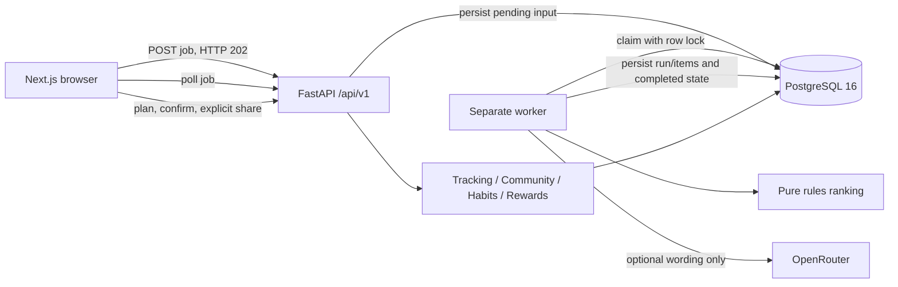

# NourishLoop system architecture

The active system is a modular FastAPI monolith (`apps/api`), a separate recommendation worker, PostgreSQL 16, and a Next.js browser (`apps/web`). Generated TypeScript contracts in `packages/api-client` connect the UI and API. This document describes the implemented W07 system; the original Week 4 proposal is preserved in [the historical archive](legacy/week04-architecture.md).

## Demonstrated data flow

The API validates requests and delegates to domain services. A persisted job decouples HTTP input from asynchronous work. The worker claims rows using PostgreSQL `FOR UPDATE SKIP LOCKED`; completed recommendation runs and items remain queryable after the worker exits. Stale claims have a lease and limited reclaim attempts. Provider failure retains deterministic explanations.

A suggestion is separate from a planned decision. Planning does not increase intake. Confirmation stores a meal log with its own nutrition snapshot and changes daily totals. Community requires an owned confirmed menu meal plus a caption and explicit share action. It cannot change nutrition or rankings. Confirmed actions can create capped daily habit events and signed credit-ledger entries. These are demo credits with no cash value.

## Design decisions and boundaries

- Keep ranking pure: constraints, catalog and goals determine rank; optional model wording cannot choose meals, alter nutrition or use payments.
- Keep API, domain logic and persistence separate within one monolith, avoiding unnecessary network services while retaining testable modules.
- Use durable jobs and PostgreSQL claims for asynchronous work; do not depend on an in-memory browser task.
- Generate browser types from FastAPI OpenAPI to reduce contract drift.
- Keep development identities gated by both development mode and demo authentication. These are not production accounts.

The broader implementation includes workout planning/completion and private photo-meal records. Photo recognition calls an external vision provider from the API, then matches USDA nutrient data; it is not the async worker demonstrated in this checkpoint. The image bytes are not persisted. Optional corrections and partial-result labels do not establish measured recognition accuracy.

The six seeded menu meals and their nutrition are fictional. Venue directory locations have attributed sources, but do not establish real menus or verified restaurant nutrition. No production authentication, public deployment or real model accuracy is claimed.

See [detailed current components](architecture/overview.md), [module boundaries](architecture/modules.md), [database schema](database/schema.md), [API contracts](api/contracts.md), and [W07 evidence](../submissions/week07/README.md).
