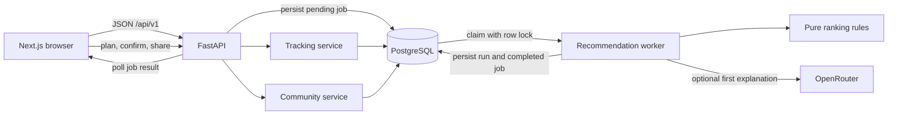

# Current NourishLoop architecture (Week 7)

NourishLoop is a modular FastAPI monolith with a separate worker, PostgreSQL, and a Next.js browser app. The current product loop is recommendation → planned decision → confirmed meal log → optional Community share. The historical Week 4 diet-plan/photo architecture remains in [`../architecture.md`](../architecture.md) as a course artifact; it is not the implemented flow.

The API authenticates the local demo user, validates requests, and delegates workflows to domain services. The recommendation job records input and provider choice. The worker claims jobs via `FOR UPDATE SKIP LOCKED`, calculates rankings from profile/goals and the catalog, optionally asks OpenRouter to reword only the first deterministic explanation, then commits the recommendation run and completed job together. Provider failure uses baseline text. The browser polls job state and displays persisted results. Scoring excludes catalog allergens and strict dietary preferences before ranking. It does not use model output or payment data.

A recommendation is a suggestion. `POST /decisions` stores a planned action; it does not change intake. `POST /meal-logs` confirms the meal and stores an immutable nutrition snapshot used by the daily summary. Community post creation requires an owned confirmed meal log and a user-entered caption. Feed data does not change nutrition totals or recommendation scores. Removing a post leaves the meal log intact.

The stack uses Python 3.12, FastAPI, SQLAlchemy, Alembic, PostgreSQL 16, Next.js, React, and TypeScript. Generated browser types come from the FastAPI OpenAPI contract. The old starter case/worker and optional Week 4 AI service remain separate from the active stack.

Only one seeded user is authenticated, and only in development/demo mode. There is no production account system, real restaurant data, verified nutrition, image analysis in the active flow, or moderation. Community is suitable only for a local fictional demo until identity, privacy controls, and moderation are implemented.
