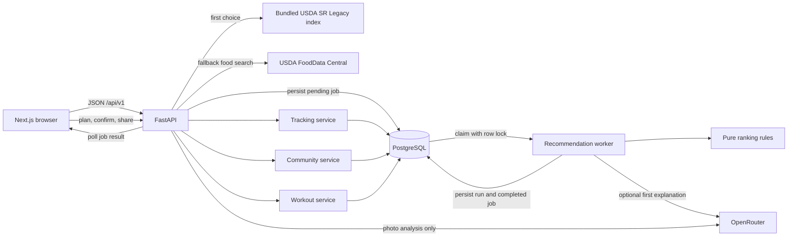

# Current NourishLoop architecture

NourishLoop is a modular FastAPI monolith with a separate worker, PostgreSQL, and a mobile-first Next.js browser app. **My plan** combines the user’s goal, four-week progress, and today’s actions. Confirmed meals and training sessions feed that progress and the next suggestions. **Progress & history** contains meal plans, confirmed menu meals, photo meals and completed workouts. Discover, Workouts, Community, Rewards and Profile have separate URL-addressable views. The historical Week 4 diet-plan/photo architecture remains in [`../legacy/week04-architecture.md`](../legacy/week04-architecture.md) as a course artifact.

The API authenticates the local demo user, validates requests, and delegates workflows to domain services. The recommendation job records input and provider choice. The worker claims jobs via `FOR UPDATE SKIP LOCKED` and ranks the catalog against the profile, goals, budget and recent confirmed meals. A seven-day history snapshot accompanies each new run. The worker optionally asks OpenRouter to reword the first deterministic explanation, then commits the run and completed job together. Provider failure uses baseline text. The pure ranking engine applies dietary filters before scoring and reduces the ranking of repeated dishes to encourage variety.

A recommendation is a suggestion. `POST /decisions` stores a planned action; it does not change intake. `POST /meal-logs` confirms the meal and stores an immutable nutrition snapshot used by the daily summary. Community post creation requires an owned confirmed meal log and a user-entered caption. Feed data does not change nutrition totals or recommendation scores. Removing a post leaves the meal log intact.

Photo recognition uses the configured OpenRouter vision model from the API. The browser downsizes and re-encodes the image before sending it; the response lists tentative visible foods, rough edible-gram estimates when discernible, and review questions. Duplicate model entries for the same food are removed before calculation. The server first matches foods against a bundled USDA SR Legacy index, then uses the FoodData Central API as a fallback, and calculates a sourced draft without requiring manual entry. The user can inspect sources and optionally correct food names, matches, and portions before saving a private photo meal record. NourishLoop does not persist image bytes or ask the model for calories/macros. A complete USDA match and edible gram estimate is required for a whole-meal total. When only some foods match, the UI shows a clearly labelled partial total for matched foods and lists excluded ingredients; names-only records remain possible. Visual portion weights are uncertain, so the UI labels the totals approximate and warns about cooking oil, sauces, and hidden ingredients. Photo meals count as confirmed meals and can earn the same once-daily meal habit credit. Daily nutrition totals include only menu-log snapshots and fully matched photo snapshots. Photo records are not currently shareable through Community.

The current extension connects confirmed actions to Habit and Reward services. The first confirmed menu or photo meal, first voluntary Community share and first completed workout on each Hong Kong local day create auditable habit events worth 5, 3 and 5 demo credits, respectively. A unique user/habit/day constraint caps credit awards. Credits are signed append-only ledger rows; badge redemption adds a negative row and is serialized by a user-row lock. Post removal or moderation adds a reversal instead of deleting credit history. Comments and likes never mint credits. Daily and weekly progress and streaks are derived from habit events. See [reward policy](rewards.md).

Community now has comments, likes, reports, a moderator queue and report resolution. A reported post stays visible until a moderator chooses removal. Author removal and moderator removal hide the post while preserving it for audit. Only the local seeded demo user receives moderator access; production identity and moderation controls are still required before public use. Food search/filter results, decisions, meal logs, Community posts and credit ledger rows use bounded server-side offsets with previous/next controls in the browser.

The Workout service chooses only sourced exercises compatible with the user's declared stage and available equipment. It checks recent completed sessions, shifts away from a muscle group trained within 48 hours when another compatible group exists, and reduces volume after the user's weekly session target. A persisted plan is a suggestion; a separate completion call creates the session and daily habit event. Optional OpenRouter output is limited to coaching wording and falls back to the grounded explanation. See [data sources](../data-sources.md).

The stack uses Python 3.12, FastAPI, SQLAlchemy, Alembic, PostgreSQL 16, Next.js, React, and TypeScript. Generated browser types come from the FastAPI OpenAPI contract. The old starter case/worker and optional Week 4 AI service remain separate from the active stack.

The browser uses the configured default identity in development/demo mode. API tests can select the seeded peer via `X-Demo-User-Id` in that mode. The public catalog keeps sourced places and dated menus separate from the fictional, recordable menu used by the recommendation engine. Sourced menu entries show reference prices when published and do not supply nutrition or allergen data. There is no production account system, public-facing moderation operations, or merchant rewards. Community is suitable only for a local demo until identity, privacy controls, rate limiting, and operational moderation are implemented. Free-tier photo analysis sends content to an external provider and is suitable only for food-only demo photos without personal details.
