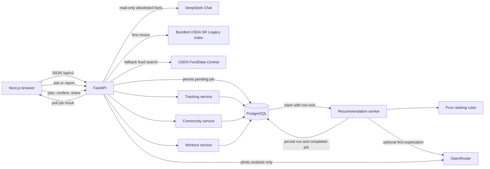

# Current NourishLoop architecture

NourishLoop is a modular FastAPI monolith with a separate worker, PostgreSQL, and a mobile-first Next.js browser app. The catalog food loop is discovery → recommendation → planned decision → confirmed meal log → optional Community share. A second food path is photo capture/upload → Recognize action → automatic vision and USDA estimate → immediate result → optional correction → optional private photo meal record. A separate workout loop is exercise discovery → stage-aware plan → confirmed session. The browser presents **Today**, **Food**, **Move**, **Progress** and **Community** as primary URL-addressable destinations. **Rewards** is opened from the top-bar points/store control, while the top-bar avatar opens **Profile**.

Today is a factual daily check-in, not a dashboard of inferred health claims. It distinguishes no food or movement records, food without movement, movement without food, and both recorded. Food consolidates Explore, For you, Meals, Real places and the two photo modes. Progressive disclosures keep secondary detail collapsed, and Progress combines the dated record with the full coach report.

The API authenticates the local demo user, validates requests, and delegates workflows to domain services. The recommendation job records input and provider choice. The worker claims jobs via `FOR UPDATE SKIP LOCKED`, calculates rankings from profile/goals and the catalog, optionally asks OpenRouter to reword only the first deterministic explanation, then commits the recommendation run and completed job together. Provider failure uses baseline text. The browser polls job state and displays persisted results. Scoring excludes catalog allergens and strict dietary preferences before ranking. It does not use model output or payment data.

## Floating coach and daily report

The active `assistant` module owns a separate DeepSeek Chat Completions provider. `POST /assistant/ask` builds a fresh read-only context, sends the current question and one grounded request, validates a short plain-text answer, and returns it. `POST /assistant/daily-report` uses the same context boundary with JSON output mode and validates the structured report. Each HTTP action causes at most one DeepSeek request. The provider and frontend do not retry automatically; any retry is a separate explicit user action. Application logs do not include questions, health context, generated answers or reports, raw provider bodies, Authorization headers, or API keys.

The bottom-right **Coach** ring opens a focused, blurred overlay with one current question and at most one answer. It does not carry a conversation transcript or prior exchange into another question, and asking another question replaces the visible exchange. Browser speech recognition may fill the input when available; the ordinary text field remains the fallback. Closing the overlay or refreshing the page clears the exchange.

**Progress** owns the full report UI. The report is held only in React component state and disappears on navigation, unmount, or refresh. Generated questions, answers, and reports are not written to PostgreSQL or browser storage, and this feature adds no table or migration. OpenRouter's existing explanation and photo-recognition integrations are unchanged.

The context builder reads only the authenticated demo user's records for the current Hong Kong-local day:

| Allowlisted context | Included fields |
|---|---|
| Profile and goal | Goal, optional daily calorie target, dietary preferences, allergies |
| Daily summary | Recorded nutrition totals and confirmed meal count |
| Confirmed menu meals | Food name, servings, consumed time, stored nutrition snapshot |
| Saved photo-review rows | Food names, user notes, review status, nutrition status, optional nutrition snapshot, unresolved foods |
| Completed workouts | Focus, stage, duration, exercise names, completion time |
| Workout profile | Declared stage, equipment, target days per week |
| Current ask | The current question for `/ask`; none for `/daily-report` |

Confirmed menu logs and completed workouts are treated as consumed activity. The context also serializes every saved photo-review row for the day with its `review_status`. Pending, processing, and failed rows are status-only with no row nutrition and are not counted as consumed. `not_requested` and `completed` rows count toward the confirmed meal count; their `complete` nutrition snapshots contribute to aggregate nutrition, while `partial` snapshots remain per-row matched-food estimates and are not aggregate intake. Planned decisions, recommendations, unsaved/current recognitions, images and image paths, photo-review attempt logs/errors, user IDs and display identity, Community content, merchant/payment data, secrets, provider job history, and prior conversation are excluded. The prompt treats the question and serialized facts as untrusted data, forbids invented records or medical claims, and asks the model to state absent records. Output is rendered as text, never raw HTML.

Missing or blank key, base URL, or model configuration and unavailable demo identity return 503. Settings validation rejects a blank, non-positive, or oversized timeout before startup, while the provider also rechecks the required values before an HTTP request. A DeepSeek timeout returns 504. Other upstream failures, unusable response envelopes, empty/invalid answers, and invalid report JSON return 502 through fixed safe messages. Malformed local requests return 422. DeepSeek is not used for recommendation ranking, workout selection, stored nutrition, rewards, or Community behavior.

A recommendation is a suggestion. `POST /decisions` stores a planned action; it does not change intake. `POST /meal-logs` confirms the meal and stores an immutable nutrition snapshot used by the daily summary. Community post creation requires an owned confirmed meal log and a user-entered caption. Feed data does not change nutrition totals or recommendation scores. Removing a post leaves the meal log intact.

Photo recognition uses the configured OpenRouter vision model from the API. The browser downsizes and re-encodes the image before sending it; the response lists tentative visible foods, rough edible-gram estimates when discernible, and review questions. Duplicate model entries for the same food are removed before calculation. The server first matches foods against a bundled USDA SR Legacy index, then uses the FoodData Central API as a fallback, and calculates a sourced draft without requiring manual entry. The user can inspect sources and optionally correct food names, matches, and portions before saving a private photo meal record. NourishLoop does not persist image bytes or ask the model for calories/macros. A complete USDA match and edible gram estimate is required for a whole-meal total. When only some foods match, the UI shows a clearly labelled partial total for matched foods and lists excluded ingredients; names-only records remain possible. Visual portion weights are uncertain, so the UI labels the totals approximate and warns about cooking oil, sauces, and hidden ingredients. Photo meals count as confirmed meals and can earn the same once-daily meal habit credit. Daily nutrition totals include only menu-log snapshots and fully matched photo snapshots. Photo records are not currently shareable through Community.

The current extension connects confirmed actions to Habit and Reward services. The first confirmed menu or photo meal, first voluntary Community share and first completed workout on each Hong Kong local day create auditable habit events worth 5, 3 and 5 demo credits, respectively. A unique user/habit/day constraint caps credit awards. Credits are signed append-only ledger rows; badge redemption adds a negative row and is serialized by a user-row lock. Post removal or moderation adds a reversal instead of deleting credit history. Comments and likes never mint credits. Daily and weekly progress and streaks are derived from habit events. See [reward policy](rewards.md).

Community now has comments, likes, reports, a moderator queue and report resolution. A reported post stays visible until a moderator chooses removal. Author removal and moderator removal hide the post while preserving it for audit. Only the local seeded demo user receives moderator access; production identity and moderation controls are still required before public use. Food search/filter results, decisions, meal logs, Community posts and credit ledger rows use bounded server-side offsets with previous/next controls in the browser.

The Workout service chooses only sourced exercises compatible with the user's declared stage and available equipment. It checks recent completed sessions, shifts away from a muscle group trained within 48 hours when another compatible group exists, and reduces volume after the user's weekly session target. A persisted plan is a suggestion; a separate completion call creates the session and daily habit event. Optional OpenRouter output is limited to coaching wording and falls back to the grounded explanation. See [data sources](../data-sources.md).

The stack uses Python 3.12, FastAPI, SQLAlchemy, Alembic, PostgreSQL 16, Next.js, React, and TypeScript. Generated browser types come from the FastAPI OpenAPI contract. The old starter case/worker and optional Week 4 AI service remain separate from the active stack.

Two seeded identities can be selected in the browser, and only in development/demo mode. This switch is not production authentication. Real restaurant **locations** are present, but real menus, verified nutrition and allergens are not. There is no production account system, public-facing moderation operations, or merchant rewards. Community is suitable only for a local demo until identity, privacy controls, rate limiting, and operational moderation are implemented. Free-tier photo analysis sends content to an external provider and is suitable only for food-only demo photos without personal details.
