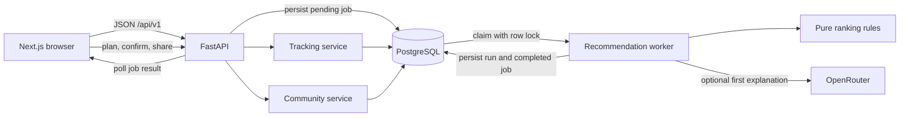

# Current NourishLoop architecture

NourishLoop is a modular FastAPI monolith with a separate worker, PostgreSQL, and a Next.js browser app. The current product loop is recommendation → planned decision → confirmed meal log → optional Community share. The historical Week 4 diet-plan/photo architecture remains in [`../architecture.md`](../architecture.md) as a course artifact; it is not the implemented flow.

The API authenticates the local demo user, validates requests, and delegates workflows to domain services. The recommendation job records input and provider choice. The worker claims jobs via `FOR UPDATE SKIP LOCKED`, calculates rankings from profile/goals and the catalog, optionally asks OpenRouter to reword only the first deterministic explanation, then commits the recommendation run and completed job together. Provider failure uses baseline text. The browser polls job state and displays persisted results. Scoring excludes catalog allergens and strict dietary preferences before ranking. It does not use model output or payment data.

A recommendation is a suggestion. `POST /decisions` stores a planned action; it does not change intake. `POST /meal-logs` confirms the meal and stores an immutable nutrition snapshot used by the daily summary. Community post creation requires an owned confirmed meal log and a user-entered caption. Feed data does not change nutrition totals or recommendation scores. Removing a post leaves the meal log intact.

The current extension connects confirmed actions to Habit and Reward services. The first confirmed meal and first voluntary Community share on each Hong Kong local day create auditable habit events worth 5 and 3 demo credits, respectively. A unique user/habit/day constraint caps credit awards. Credits are signed append-only ledger rows; badge redemption adds a negative row and is serialized by a user-row lock. Post removal or moderation adds a reversal instead of deleting credit history. Comments and likes never mint credits. Daily and weekly progress and streaks are derived from habit events. See [reward policy](rewards.md).

Community now has comments, likes, reports, a moderator queue and report resolution. A reported post stays visible until a moderator chooses removal. Author removal and moderator removal hide the post while preserving it for audit. Only the local seeded demo user receives moderator access; production identity and moderation controls are still required before public use.

The stack uses Python 3.12, FastAPI, SQLAlchemy, Alembic, PostgreSQL 16, Next.js, React, and TypeScript. Generated browser types come from the FastAPI OpenAPI contract. The old starter case/worker and optional Week 4 AI service remain separate from the active stack.

Two seeded identities can be selected in the browser, and only in development/demo mode. This switch is not production authentication. There is no production account system, real restaurant data, verified nutrition, image analysis in the active flow, public-facing moderation operations, or merchant rewards. Community is suitable only for a local fictional demo until identity, privacy controls, rate limiting, and operational moderation are implemented.
