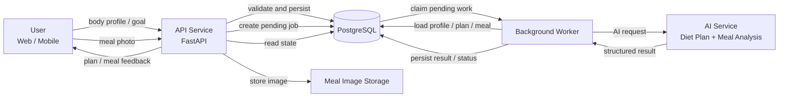

# Week 4 Submission — Team Architecture Proposal and Project Plan

## Team information

- Team name: [TBD]
- Repository: `Wzyoung203/MAIE6000C-starter-wzy`
- Checkpoint tag: `w04-proposal`
- Team members: [Zhang Boxiang , Yang Sibo , Wang Ziyang , Li Zimu]

---

## 1. Problem context

### What problem are we solving?

People who want to reduce body weight or body-fat percentage may receive general dietary advice, but they often have difficulty determining whether the meals they actually eat are consistent with their goals.

Our project proposes an AI-enabled diet planning and meal analysis platform.

The system first collects user-provided body information and a target such as target weight or target body-fat percentage. Based on this information, the platform generates a personalized dietary plan.

After the plan has been generated, the user can upload a photo of each meal. The system analyzes the meal image, compares the identified food with the user's current diet plan, and returns feedback on whether the meal is aligned with the plan and how it could be improved.

The project focuses on general wellness and dietary guidance. It is not intended to diagnose medical conditions or replace professional medical or dietetic advice.

### Who is the primary user?

The primary user is an individual who wants to manage body weight or body-fat goals and needs ongoing support in following a dietary plan.

### Why does this workflow matter?

Generating a diet plan is only the first step. Users also need support when making daily food choices.

Our platform connects the initial diet-planning stage with continuous meal-level feedback:

`Body Profile → Diet Plan → Meal Photo → AI Analysis → Plan Comparison → Feedback`

This creates a practical feedback loop between a user's long-term goal and their everyday meals.

---

## 2. User workflow

The primary workflow is:

1. The user submits basic body information such as height, weight, activity level, and a target weight or target body-fat percentage.

2. The API validates required fields and checks that the submitted values are in acceptable formats and ranges.

3. The system persists the user's body profile and goal in PostgreSQL.

4. The API creates a `DietPlan` request and a `generate_diet_plan` asynchronous job with an initial `pending` status.

5. A background worker claims the job, loads the user's body profile, calls the AI-enabled diet-planning function, validates the returned result, and persists the generated diet plan.

6. The user uploads a photo of a meal. The API validates the upload, creates a `Meal` record, stores an image reference, and creates an `analyze_meal` job.

7. The worker claims the meal-analysis job, loads the uploaded meal and active diet plan, and calls a multimodal AI function to identify the main foods and compare the meal with the current plan.

8. The system persists the meal-analysis result, including an alignment assessment, confidence information, and feedback. The user can then retrieve the result through the platform.

### Exception path

If AI processing fails:

`processing → failed → retry / request new image / visible error`

The original user, diet-plan, and meal records remain persisted. The related job stores failure information so that the problem can be retried or diagnosed.

If a meal image is too unclear for reliable analysis, the system can ask the user to upload a clearer image.

---

## 3. Success criteria

### Product KPI

The primary product KPI is:

**Meal feedback completion rate** — the percentage of valid submitted meal photos for which the platform successfully returns a persisted analysis and actionable feedback.

For the first vertical slice, success means that a user can complete the full workflow:

`Profile → Diet Plan → Meal Photo → Meal Analysis → Feedback`

without manual database intervention.

### Operational KPI

The primary operational KPIs are:

- end-to-end job completion rate;
- percentage of jobs ending in `failed`;
- processing latency from job creation to completion;
- AI-service failure or timeout rate.

For the Week 7 vertical slice, the main operational goal is a reliable and reproducible end-to-end workflow rather than production-scale performance.

---

## 4. Architecture summary

The project will preserve the engineering structure demonstrated by the starter repository:

`API → PostgreSQL → Job → Worker → AI Service → Persisted Result → API Retrieval`

### Main components

#### User Interface

Responsibilities:

- collect body information and goals;
- display generated diet plans;
- upload meal photos;
- display meal-analysis results and feedback.

#### API Service

Responsibilities:

- validate user input;
- create and retrieve persistent records;
- create asynchronous jobs;
- expose current diet-plan and meal-analysis state.

Long-running AI processing will not happen directly inside the HTTP request cycle.

#### PostgreSQL

Responsibilities:

- store durable application state;
- store user profiles;
- store diet plans;
- store meal metadata;
- store meal-analysis results;
- store job state and timestamps.

Database records represent the durable system state over time.

#### Background Worker

Responsibilities:

- poll for pending jobs;
- claim work;
- load related persistent records;
- call the AI service;
- validate returned results;
- update completed or failed state.

#### AI Service

The AI layer supports two initial functions:

1. personalized diet-plan generation;
2. meal-image analysis and comparison with the current diet plan.

### Architecture flow

The MVP will continue using database-persisted jobs and worker polling rather than introducing an additional queue technology unless it becomes necessary.

---

## 5. Data model and persistence plan

The MVP will use six main persistent entities.

### `users`

Represents the stable owner of the platform data.

Important fields:

- `id`
- `created_at`
- `updated_at`

### `body_profiles`

Stores a snapshot of the body information used to generate a diet plan.

Important fields:

- `id`
- `user_id`
- `height_cm`
- `weight_kg`
- `activity_level`
- `target_weight_kg`
- `target_body_fat_pct`
- `created_at`

Relationship:

`users.id → body_profiles.user_id`

### `diet_plans`

Stores the generated dietary plan and its lifecycle.

Important fields:

- `id`
- `user_id`
- `body_profile_id`
- `status`
- `daily_calorie_target`
- `protein_target_g`
- `carb_target_g`
- `fat_target_g`
- `guidance_text`
- `model_version`
- `prompt_template_version`
- `processed_at`
- `created_at`
- `updated_at`

Relationships:

- `users.id → diet_plans.user_id`
- `body_profiles.id → diet_plans.body_profile_id`

Expected lifecycle:

`pending → active`

Failure:

`pending → failed`

Replacement:

`active → superseded`

### `meals`

Stores metadata for a submitted meal.

Important fields:

- `id`
- `user_id`
- `diet_plan_id`
- `image_ref`
- `eaten_at`
- `status`
- `created_at`
- `updated_at`

Relationships:

- `users.id → meals.user_id`
- `diet_plans.id → meals.diet_plan_id`

Expected lifecycle:

`uploaded → processing → analyzed`

Failure:

`processing → failed`

The database will store an image reference rather than the raw image binary.

### `meal_analyses`

Stores the AI-generated analysis of a meal.

Important fields:

- `id`
- `meal_id`
- `diet_plan_id`
- `detected_foods`
- `alignment_status`
- `feedback`
- `confidence`
- `model_version`
- `prompt_template_version`
- `processed_at`

Possible alignment states:

- `aligned`
- `partially_aligned`
- `not_aligned`

Relationships:

- `meals.id → meal_analyses.meal_id`
- `diet_plans.id → meal_analyses.diet_plan_id`

Keeping `diet_plan_id` on the analysis makes it possible to identify exactly which plan was used for the comparison.

### `jobs`

Represents asynchronous work.

Important fields:

- `id`
- `job_type`
- `diet_plan_id`
- `meal_id`
- `status`
- `attempts`
- `error`
- `created_at`
- `claimed_at`
- `completed_at`
- `updated_at`

Initial job types:

- `generate_diet_plan`
- `analyze_meal`

Lifecycle:

`pending → claimed → completed`

Failure:

`claimed → failed`

---

## 6. API / service plan

The exact API contract will be finalized during Week 5.

Initial endpoints may include:

| Method | Endpoint | Purpose |
|---|---|---|
| `POST` | `/users/{user_id}/profiles` | Create a body-profile snapshot |
| `GET` | `/users/{user_id}/profiles/latest` | Retrieve the latest profile |
| `POST` | `/diet-plans` | Request diet-plan generation |
| `GET` | `/diet-plans/{plan_id}` | Retrieve diet plan or processing status |
| `POST` | `/meals` | Upload/create a meal |
| `GET` | `/meals/{meal_id}` | Retrieve meal state |
| `GET` | `/meals/{meal_id}/analysis` | Retrieve AI meal analysis |
| `GET` | `/jobs/{job_id}` | Retrieve asynchronous job state |
| `GET` | `/health/live` | Service liveness check |
| `GET` | `/health/ready` | Service readiness check |

Authentication and authorization are not required for the first vertical slice. A stable demo user may be used initially so that development remains focused on the core product workflow.

---

## 7. Async / worker plan

AI operations will happen outside the immediate HTTP request cycle.

Two background job types are planned.

### `generate_diet_plan`

Flow:

1. API creates a diet-plan request.
2. API creates a `pending` job.
3. Worker claims the job.
4. Worker loads the associated body profile.
5. Worker calls the diet-plan AI function.
6. Worker validates the response.
7. Worker persists the generated diet plan.
8. Diet plan becomes `active`.
9. Job becomes `completed`.

Failure behavior:

- job becomes `failed`;
- diet plan becomes `failed`;
- error information is persisted.

### `analyze_meal`

Flow:

1. API receives and validates a meal upload.
2. API creates a meal record.
3. API creates an `analyze_meal` job.
4. Worker claims the job.
5. Worker loads the meal and associated diet plan.
6. Worker calls the multimodal AI service.
7. Worker validates the response.
8. Worker persists a `MealAnalysis`.
9. Meal becomes `analyzed`.
10. Job becomes `completed`.

Failure behavior:

- job becomes `failed`;
- meal becomes `failed` where appropriate;
- diagnostic error information is persisted;
- retry or image re-upload may be offered.

---

## 8. AI-enabled component

### What is the AI-enabled function?

The project contains two AI-enabled functions.

#### Diet-plan generation

The AI receives body-profile and goal information and produces a structured dietary plan containing high-level calorie/macronutrient targets and general dietary guidance.

#### Meal analysis

A multimodal AI model receives an uploaded meal image and the user's active diet plan.

The AI attempts to:

- identify the main foods in the image;
- estimate relevant meal characteristics;
- compare the meal with the current diet plan;
- assign an alignment assessment;
- generate concise feedback and suggestions.

### Why is AI appropriate?

The input and output contain information that is difficult to represent using only fixed rules.

Meal analysis requires interpretation of visual information, while diet-plan and feedback generation require converting structured user goals and meal observations into useful natural-language guidance.

The AI output will remain part of a controlled engineering workflow rather than being treated as unquestioned system truth.

### AI traceability

For each AI operation, the system should preserve enough evidence to understand how the result was created.

Possible traceability information includes:

- input record reference;
- diet-plan version/reference;
- model version;
- prompt/template version;
- AI output;
- confidence/uncertainty information;
- processing timestamp;
- job ID.

### Fallback or review path

Possible fallback behavior includes:

- retrying transient AI-service failures;
- asking the user to upload a clearer meal image;
- marking a low-confidence result as uncertain;
- optionally routing uncertain results to human review in a later version.

If a reviewer overrides an AI result in a future version, the system should preserve both the original AI result and the reason for the override.

The exact confidence threshold for review will be decided during implementation and testing.

### Sensitive information

Raw personal body data, credentials, complete AI prompts containing personal information, and image contents should not be copied into standard application logs.

Logs should prefer IDs such as:

- `user_id`
- `diet_plan_id`
- `meal_id`
- `job_id`

together with status, processing duration, error type, and other operational metadata.

---

## 9. Milestone plan

### Week 5 target

- finalize the first API contract;
- finalize the first database schema;
- create required Alembic migrations;
- implement the first API → PostgreSQL persistence path;
- create initial body-profile and diet-plan request records.

### Week 7 target

Deliver the first complete end-to-end vertical slice:

`Body Profile → Diet Plan → Meal Photo → AI Analysis → Plan Comparison → Feedback`

Minimum successful outcome:

- user profile can be persisted;
- diet-plan generation can complete asynchronously;
- a meal image can be submitted;
- meal-analysis processing can complete asynchronously;
- result can be persisted and retrieved.

### Week 9 target

- reproducible Docker-based deployment;
- documented startup procedure;
- API, PostgreSQL, worker, and AI-related services can be started consistently;
- another team member can clone the repository and reproduce the system.

### Week 11 target

Improve:

- structured logging;
- failure handling;
- retry behavior;
- health checks;
- AI-service timeout handling;
- low-confidence result behavior;
- observability;
- basic performance/latency measurement.

### Week 13 target

- complete and tested primary workflow;
- integration and smoke tests;
- final architecture and operations documentation;
- reproducible live demonstration;
- final scope review and cleanup.

---

## 10. Risks and scope control

### Top risk 1: Meal-image analysis accuracy

A single meal image may not provide enough information to accurately identify every food item or estimate portion size.

Mitigation:

- treat portion and nutrition estimates as approximate;
- focus the MVP on qualitative plan alignment;
- expose uncertainty where possible;
- ask for a clearer image if the input is insufficient.

### Top risk 2: AI reliability and inappropriate output

AI services may fail, time out, produce malformed responses, or return unreliable dietary recommendations.

Mitigation:

- use asynchronous jobs;
- validate structured AI responses;
- persist explicit failure states;
- use timeout and retry handling;
- keep the system focused on general wellness;
- avoid diagnosis or disease-specific advice.

### Top risk 3: Project scope

The project can become too large if it attempts accurate nutrition estimation, dashboards, progress prediction, notifications, social features, and human review at the same time.

Mitigation:

The team will prioritize one complete vertical slice before optional features.

### Additional risks

- sensitive user/body data;
- non-deterministic AI outputs;
- external AI availability or rate limits;
- image storage complexity;
- schema changes later in the semester.

### First features we will cut if progress slips

The first scope cuts will be:

1. exact portion-size estimation;
2. exact calorie estimation from a meal photograph;
3. advanced dashboard and visualizations;
4. long-term weight/body-fat prediction;
5. full human nutritionist review workflow;
6. notification and reminder features;
7. social/community features;
8. shopping-list generation;
9. recipe recommendations;
10. multiple-model routing.

If further simplification is required, meal analysis will return only:

- `aligned`
- `partially_aligned`
- `not_aligned`

plus a short textual recommendation.

---

## 11. Artifact index

The following artifacts support the Week 4 proposal.

- `docs/architecture.md`  
  Full architecture proposal including workflow, components, data model, worker/AI plan, state transitions, AI traceability, milestones, risks, and scope control.

- ERD  
  Database schema diagram covering:
  - `users`
  - `body_profiles`
  - `diet_plans`
  - `meals`
  - `meal_analyses`
  - `jobs`

- Architecture diagram  
  End-to-end architecture flow showing:
  - User
  - API service
  - PostgreSQL
  - Worker
  - AI service
  - persistent result retrieval

- API draft  
  Initial proposed endpoints for profiles, diet plans, meals, analyses, jobs, and health checks.

- State transition table  
  Defines which actor is allowed to change the state of `DietPlan`, `Meal`, `MealAnalysis`, and `Job` records and what evidence is persisted.

- Risk register and scope plan  
  Documents major technical/product risks and features that will be cut first if progress slips.

- `submissions/week04/README.md`  
  Concise Week 4 architecture proposal and project plan.

---

## 12. AI Use Statement

Generative AI tools were used to assist with the preparation of this Week 4 milestone.

AI assistance was used for:

- reviewing and explaining the starter repository architecture;
- identifying relevant starter API, worker, model, migration, and test evidence;
- brainstorming and refining the proposed primary workflow;
- drafting candidate database entities and relationships;
- drafting the state-transition responsibility table;
- organizing AI traceability and failure-handling considerations;
- drafting milestone, risk, and scope-control sections;
- helping prepare initial architecture and ERD representations;
- editing and organizing proposal documentation.

The team did not treat AI-generated content as authoritative.

The proposed design was checked against:

- the Week 4 lab requirements;
- the existing starter repository structure;
- the starter's API → PostgreSQL → worker → AI processing pattern;
- the project team's intended product workflow.

The team will manually review the final architecture, schema, API design, and implementation decisions before creating the `w04-proposal` checkpoint tag.