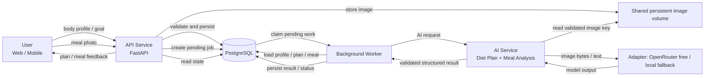

# Week 4 Submission — Team Architecture Proposal and Project Plan

## Team information

- Team name: group14
- Repository: https://github.com/Wzyoung203/MAIE6000C-starter-wzy
- Required checkpoint tag: `w04-proposal`
- Team members: Zhang Boxiang, Yang Sibo, Wang Ziyang, Li Zimu
- Project title: AI Diet Planning and Meal Analysis Platform
- Proposal branch: `boxiang/w04-calorie-proposal`
- Proposal contact/editor: Zhang Boxiang
- Preparation date: 2026-10-07 (Asia/Hong_Kong)
- Status: proposal; model/data integrations and meal features are planned

---

## 1. Problem context

### What problem are we solving?

People who want to reduce body weight or body-fat percentage may receive general dietary advice, but they often have difficulty determining whether the meals they actually eat are consistent with their goals.

Our project proposes an AI-enabled diet planning and meal analysis platform.

The system first collects user-provided body information and a target such as target weight or target body-fat percentage. Based on this information, the platform generates a personalized dietary plan.

After the plan has been generated, the user can upload a photo of each meal. The system analyzes the meal image, compares the identified food with the user's current diet plan, and returns estimated calories/macronutrients and explainable meal-budget feedback. Users supply grams or supported count/size inputs, correct food/preparation choices and confirm the result.

The project focuses on general wellness and dietary guidance. It is not intended to diagnose medical conditions or replace professional medical or dietetic advice.

### Who is the primary user?

The primary user is an individual who wants to manage body weight or body-fat goals and needs ongoing support in following a dietary plan.

### Why does this workflow matter?

Generating a diet plan is only the first step. Users also need support when making daily food choices.

Our platform connects the initial diet-planning stage with continuous meal-level feedback:

`Body Profile → Diet Plan → Meal Photo + Quantities → AI Analysis → User Confirmation → Plan Comparison → Feedback`

This creates a practical feedback loop between a user's long-term goal and their everyday meals.

---

## 2. User workflow

1. User provides body information and a goal; API validates and persists a profile snapshot. Hosted course demos use synthetic profiles.
2. API creates a pending plan/generation job in one transaction and returns IDs with `202`. Worker validates AI targets/meal-budget fractions before atomic activation; failed replacement leaves the old plan active.
3. User uploads a photo, eating time/slot and optional notes such as `150 g cooked beef; 2 large eggs`. API stores a generated shared-volume reference, binds the active plan and creates a job transactionally.
4. Worker calls AI for food/quantity interpretation, resolves versioned nutrition/portion entries, calculates a draft, and requests grounded explanation of complete computed values where available.
5. User reviews foods/preparation, grams/count/size, source conversions and missing ingredients. API recalculates calories/macros/alignment, stores an immutable revision and exposes feedback/history/daily totals.

### Exception path

Unclear images, unsupported food or unknown portions produce review questions, not invented values. Failed jobs persist and allow explicit retry or manual catalog entry. Ordinary user confirmation is MVP; nutritionist review is optional. Late results cannot overwrite confirmed corrections. No active plan produces a clear conflict. Original AI output stays separate from corrected values; all nutrition remains an estimate.

---

## 3. Success criteria

- **Product:** at least 18/20 eligible held-out meals reach persisted, confirmed nutrition/plan feedback through the real-model route; report manual completion separately.
- **AI:** at least 18/20 schema-valid drafts, food/preparation precision ≥0.85 and recall ≥0.80, quantity parsing ≥90% before correction.
- **Nutrition:** report calorie MAE/relative error against independently checked catalog references; provisional complete-draft mean relative error ≤20%, with coverage/exclusions stated. Confirmed same-source calculation differs by at most 0.1 kcal display rounding, not a claim of laboratory accuracy.
- **Operations:** attempts/provider calls, quota use, failures/timeouts and warm upload-to-review p95 target ≤150 seconds for up to two model calls; report cold start and failures separately.
- **Durability:** restart preserves source snapshots, original AI output and confirmed revisions; unknown inputs never become silent zero values.

Week 5 uses ten development photos; freeze a separate twenty-meal test set and five exception cases before Week 7. Second-member label/reference checks and failure injections are described in [evaluation-plan.md](../../docs/evaluation-plan.md). These are proposed team targets, not achieved results or extra course requirements.

---

## 4. Architecture summary

The project will preserve the engineering structure demonstrated by the starter repository:

`API → PostgreSQL → Job → Worker → AI Service → Persisted Result → API Retrieval`

### Main components

#### User Interface

Responsibilities:

- collect body information and goals;
- display generated diet plans;
- upload meal photos;
- display editable foods/quantities, sources and feedback;
- confirm corrections and retrieve history/daily totals.

#### API Service

Responsibilities:

- validate user input;
- create and retrieve persistent records;
- create asynchronous jobs;
- expose current diet-plan and meal-analysis state;
- perform deterministic nutrition calculation and confirmation transactions.

Long-running AI processing will not happen directly inside the HTTP request cycle.

#### PostgreSQL

Responsibilities:

- store durable application state;
- store user profiles;
- store diet plans;
- store meal metadata;
- store meal-analysis results;
- store job state and timestamps;
- store source-backed nutrition/portions and immutable correction revisions.

Database records represent the durable system state over time.

#### Background Worker

Responsibilities:

- poll for pending jobs;
- claim work;
- load related persistent records;
- call the AI service;
- validate returned results;
- update completed or failed state.

#### AI Service

The AI layer supports two initial functions:

1. personalized diet-plan generation;
2. meal-image analysis and comparison with the current diet plan.

### Architecture flow



The MVP will continue using database-persisted jobs and worker polling rather than introducing an additional queue technology unless it becomes necessary.

---

## 5. Data model and persistence plan

Retain the six original workflow entities and add four supporting entities for nutrition, count conversion and corrections. Detailed fields/constraints and ERD are in `docs/architecture.md`.

### `users`

Represents the stable owner of the platform data.

Important fields:

- `id`
- `created_at`
- `updated_at`

### `body_profiles`

Stores a snapshot of the body information used to generate a diet plan.

Important fields:

- `id`
- `user_id`
- `height_cm`
- `weight_kg`
- `activity_level`
- `target_weight_kg`
- `target_body_fat_pct`
- `created_at`

Relationship:

`users.id → body_profiles.user_id`

### `diet_plans`

Stores the generated dietary plan and its lifecycle.

Important fields:

- `id`
- `user_id`
- `body_profile_id`
- `status`
- `daily_calorie_target`
- `protein_target_g`
- `carb_target_g`
- `fat_target_g`
- `guidance_text`
- `meal_budget_fractions` / `comparison_rule_version`
- `generated_by_job_id` / `original_ai_output`
- `model_version`
- `prompt_template_version`
- `processed_at`
- `created_at`
- `updated_at`

Relationships:

- `users.id → diet_plans.user_id`
- `body_profiles.id → diet_plans.body_profile_id`

Expected lifecycle:

`pending → active`

Failure:

`pending → failed`

Replacement:

`active → superseded`

### `meals`

Stores metadata for a submitted meal.

Important fields:

- `id`
- `user_id`
- `diet_plan_id`
- `image_ref`
- `eaten_at` / `meal_slot` / `quantity_notes`
- `input_revision` / `confirmed_revision` / `confirmed_totals`
- `status`
- `created_at`
- `updated_at`

Relationships:

- `users.id → meals.user_id`
- `diet_plans.id → meals.diet_plan_id`

Expected lifecycle:

`uploaded → processing → needs_review → analyzed`

`analyzed` means a confirmed, recalculated revision exists; recognition alone yields `needs_review`.

Failure:

`processing → failed`

The database will store an image reference rather than the raw image binary.

### `meal_analyses`

Stores the AI-generated analysis of a meal.

Important fields:

- `id`
- `meal_id`
- `diet_plan_id`
- unique `job_id`, `input_revision`, `original_ai_output`
- `detected_foods` / `draft_totals` / `provider_metadata` / `uncertainty_reasons`
- `alignment_status` (null for incomplete drafts)
- `feedback`
- `confidence`
- `model_version`
- `prompt_template_version`
- `processed_at`

Possible alignment states:

- `aligned`
- `partially_aligned`
- `not_aligned`

Relationships:

- `meals.id → meal_analyses.meal_id`
- `diet_plans.id → meal_analyses.diet_plan_id`

Keeping `diet_plan_id` preserves the referenced plan. A meal may have multiple original-output analyses, each linked to a unique job; analysis is created only on a validated result and has no processing lifecycle of its own.

### `jobs`

Represents asynchronous work.

Important fields:

- `id`
- `job_type`
- `diet_plan_id`
- `meal_id`
- `status`
- `attempts`
- `error` / `error_code`
- `next_attempt_at` / `claim_token` / `lease_expires_at`
- `input_revision` / `input_snapshot`
- `created_at`
- `claimed_at`
- `completed_at`
- `updated_at`

Initial job types:

- `generate_diet_plan`
- `analyze_meal`

Lifecycle:

`pending → claimed → completed`

Failure:

`claimed → failed`

Transient failures may requeue within three attempts. Enforce exactly one job target compatible with its type, one active plan per owner, one active meal job, and unique result per job.

### Supporting entities

| Entity | Purpose |
|---|---|
| `nutrition_foods` | Versioned source/preparation and energy/macros per 100 g |
| `food_portions` | Source-backed unit/size → edible grams |
| `meal_items` | Current confirmed items, normalized quantities and source density snapshots |
| `meal_revisions` | Immutable items/totals/plan-comparison snapshot, source analysis and reason |

AI interprets images/notes; code calculates `grams × nutrient_per_100g / 100`. Count conversion requires supported size/preparation. Missing values remain unresolved. Comparison uses the plan's slot fraction and versioned calorie/macro rules. See [nutrition-model-plan.md](../../docs/nutrition-model-plan.md).

---

## 6. API / service plan

| Method | Endpoint | Purpose |
|---|---|---|
| POST | `/users/{user_id}/profiles` | Persist profile snapshot |
| GET | `/users/{user_id}/profiles/latest` | Latest profile |
| POST / GET | `/diet-plans`, `/diet-plans/{plan_id}` | `202` plan/job creation; state retrieval |
| GET | `/users/{user_id}/diet-plans/active` | Active plan |
| POST / GET | `/meals`, `/meals/{meal_id}` | Multipart photo/time/slot/notes; processing/result |
| GET | `/meals/{meal_id}/analysis` | Explicit pending/failed/draft/result envelope |
| GET | `/nutrition-foods` | Source food/preparation/portion search |
| PUT / GET | `/meals/{meal_id}/confirmation`, `/meals/{meal_id}/revisions` | Corrected items/recalculation; history |
| GET / POST | `/jobs/{job_id}`, `/jobs/{job_id}/retry` | Job state; explicit new job after failure |
| GET | `/meals`, `/users/{user_id}/daily-summary` | Local-day pagination; confirmed totals by original plan |
| GET | `/health/live`, `/health/ready` | Liveness/readiness |

Examples/internal contracts: [api-draft.md](../../docs/api-draft.md). Distinguish 202 pending, 404 unknown, 409 absent plan/active duplicate/stale revision, 413 size, 415 type and 422 invalid input. Private first slice uses server-resolved demo ownership; public/multiuser release requires auth. Proposed meal routes are not implemented in the starter.

---

## 7. Async / worker plan

`generate_diet_plan`: snapshot → structured AI targets → validation → atomic activation/superseding and completion. Failure preserves the previous active plan.

`analyze_meal`: image/notes → recognition → source lookup/conversion/calculation → optional grounded AI explanation → persisted review draft. User confirmation saves the effective result/revision.

Short PostgreSQL locking claims assign a token/lease and commit before inference. Publish domain/result/job together. Defaults: two-second poll, maximum three attempts, five/fifteen-second backoff; schedule provider Retry-After. Bad inputs/plan or recognition output, missing configuration and known daily exhaustion fail visibly. Explanation-only failure preserves the draft with template feedback/warning.

Provider call cap: 50 seconds each; two-call meal request: 120 seconds; lease: 180 seconds. Recover expired claims within the same attempt budget, reject stale tokens/input revisions and prevent duplicate results. Manual confirmation is never overwritten by late success/failure. Explicit retry creates a new job and retains history. These are planned settings to verify, not existing starter features.

---

## 8. AI-enabled component

Keep both AI functions: structured diet-plan generation and photo/quantity interpretation. AI explains computed nutrition/plan feedback; versioned source values and application rules control calories/alignment. User confirmation handles mistakes.

First evaluate explicit free OpenRouter multimodal candidates as requested by the team; concrete candidate, official sources, quota/data-policy gates and local Ollama fallback are in [nutrition-model-plan.md](../../docs/nutrition-model-plan.md). The free trial candidate is not food-validated/account-tested; it discloses provider logging. Use synthetic profiles/non-sensitive consented food photos and no paid automatic fallback. Free access does not imply open licensing or privacy. Verify local hardware before claiming fallback availability.

The team intends a bounded open food-model training/adaptation experiment after the pretrained baseline, subject to data/license/compute gates. Nutrient-table import is not model training. Compare against an untouched test set; cut training before core features if resources fail.

Preserve original output, provider/model/request/prompt IDs, input revision, source/conversion/rule versions and corrected revisions. Model uncertainty is not a calibrated probability. Ordinary confirmation is MVP; nutritionist review is optional. Fixtures/manual completion do not replace genuine AI evaluation.

---

## 9. Milestone plan

| Week | Deliverable/evidence |
|---|---|
| 5 | Free-provider access/quota/policy and local-hardware gates; reviewed nutrition/portion seed; contract/migrations and first persistent records |
| 7 | Real profile → plan → image/quantity → confirmed nutrition → plan feedback/history; frozen evaluation separates AI/manual results |
| 9 | Second-member reproduction/restart persistence; at most one gated small adaptation experiment |
| 11 | Timeout/crash/duplicate/late-write/stale-revision checks; bounded retries and latency/failure measurements |
| 12 | Internal freeze/rehearsal |
| 13 | Tested final loop, final docs, genuine-model demonstration and evaluation report |

The planned owner/reviewer allocation is complete in [team-plan.md](../../docs/team-plan.md): Yang Sibo leads UI/workflow, Zhang Boxiang leads API/schema/calculation, Li Zimu leads AI/data/evaluation, and Wang Ziyang leads worker/deployment/reliability. It is a planning allocation, not a claim of completed member work. Acceptance definitions: [evaluation-plan.md](../../docs/evaluation-plan.md).

---

## 10. Risks and scope control

### Top risk 1: Meal-image analysis accuracy

A single meal image may not provide enough information to accurately identify every food item or estimate portion size.

Mitigation:

- treat portion and nutrition estimates as approximate;
- use user grams or verified count/size conversions;
- source approximate calories/macros from a versioned catalog;
- compare against a documented meal budget and preserve assumptions;
- expose uncertainty where possible;
- ask for a clearer image if the input is insufficient.

### Top risk 2: AI reliability and inappropriate output

AI services may fail, time out, produce malformed responses, or return unreliable dietary recommendations.

Mitigation:

- use asynchronous jobs;
- validate structured AI responses;
- persist explicit failure states;
- use timeout and retry handling;
- keep the system focused on general wellness;
- avoid diagnosis or disease-specific advice.

### Top risk 3: Project scope

The project can become too large if it attempts accurate nutrition estimation, dashboards, progress prediction, notifications, social features, and human review at the same time.

Mitigation:

The team will prioritize one complete vertical slice before optional features.

### Additional risks

- sensitive user/body data;
- non-deterministic AI outputs;
- free-provider access/quota/data policy and model licensing;
- local hardware or training data/compute unavailable;
- unsupported conversions/raw-cooked mismatches;
- stale or duplicate results overwriting corrections;
- image storage complexity;
- schema changes later in the semester.

### First features we will cut if progress slips

The first scope cuts will be:

1. exact portion-size estimation;
2. exact calorie estimation from a meal photograph;
3. advanced dashboard and visualizations;
4. long-term weight/body-fat prediction;
5. full human nutritionist review workflow;
6. notification and reminder features;
7. social/community features;
8. shopping-list generation;
9. recipe recommendations;
10. advanced multiple-model routing;
11. training if data/compute/schedule gates fail.

If simplification is required, narrow supported foods, simplify the browser UI and use short computed/template feedback. Keep user quantities, approximate sourced calories, correction history and real AI. Rich macro charts/training are optional; exact photo-only precision is not promised.

---

## 11. Artifact index

The following artifacts support the Week 4 proposal.

- `docs/architecture.md`  
  Full architecture proposal including workflow, components, data model, worker/AI plan, state transitions, AI traceability, milestones, risks, and scope control.

- ERD  
  Database schema diagram covering:
  - `users`
  - `body_profiles`
  - `diet_plans`
  - `meals`
  - `meal_analyses`
  - `jobs`
  - `nutrition_foods`
  - `food_portions`
  - `meal_items`
  - `meal_revisions`

- Architecture diagram  
  End-to-end architecture flow showing:
  - User
  - API service
  - PostgreSQL
  - Worker
  - AI service
  - persistent result retrieval

- API draft  
  Initial proposed endpoints for profiles, diet plans, meals, analyses, jobs, and health checks.

- State transition table  
  Defines which actor is allowed to change the state of `DietPlan`, `Meal`, `MealAnalysis`, and `Job` records and what evidence is persisted.

- Risk register and scope plan  
  Documents major technical/product risks and features that will be cut first if progress slips.

- `docs/nutrition-model-plan.md`: source/conversion/rules, model gates and training.
- `docs/api-draft.md`: examples, service contracts and exceptions.
- `docs/evaluation-plan.md`: evaluation set, KPIs, failure checks and milestone evidence.
- `docs/team-plan.md`: completed project/team record, named planning owners/reviewers and integration sequence.
- `submissions/week04/ai-use-statement.md`: tools, team-supplied decisions, rejected rewrite, agent checks and limitations.
- `submissions/week04/README.md`: primary proposal.

---

## 12. AI Use Statement

**OpenAI Codex** assisted this revision. Zhang Boxiang supplied the nutrition/quantity and provider decisions, rejected an earlier rewrite that removed diet-plan generation, and requested the repaired proposal on his branch. Codex preserved the teammate's original product loop, repaired technical gaps, checked source documentation and verified document consistency.

The complete [AI Use Statement](ai-use-statement.md) distinguishes supplied team decisions and agent checks from future implementation/evaluation. No independent whole-team review, model inference, data import or training result is claimed.

## Submission record

- Team: **group14**.
- Repository: https://github.com/Wzyoung203/MAIE6000C-starter-wzy.
- Project title: **AI Diet Planning and Meal Analysis Platform**.
- Required repository checkpoint: **w04-proposal**.
- Primary artifact: **submissions/week04/README.md**.
- Proposal branch: **boxiang/w04-calorie-proposal**.
- Membership and planning owners/reviewers: [team-plan.md](../../docs/team-plan.md).

The Canvas record must use the full commit SHA resolved from the required tag, rather than assuming the branch tip is the tagged commit. Publication records may follow the tagged proposal commit. Canvas submission itself is a separate action; this repository does not claim it has been submitted.

### Completed Canvas record

The checkpoint resolves to the proposal commit below. This record was added after tagging so its full SHA can be recorded without a self-referencing commit hash. The branch tip may therefore be newer than the checkpoint; the tag remains the authoritative proposal snapshot.

```text
Repository: https://github.com/Wzyoung203/MAIE6000C-starter-wzy
  Required tag: w04-proposal
  Tagged commit SHA: 95e35a76e5d56071293801dfb9cd4124f69c7ab7
  Primary artifact: submissions/week04/README.md
  Team name: group14
  Selected brief or project title: AI Diet Planning and Meal Analysis Platform
  Optional note: Proposal branch boxiang/w04-calorie-proposal; AI Use Statement: submissions/week04/ai-use-statement.md.
```

Copyable record: [canvas-submission.txt](canvas-submission.txt). The record is prepared; submission to Canvas is not claimed.
