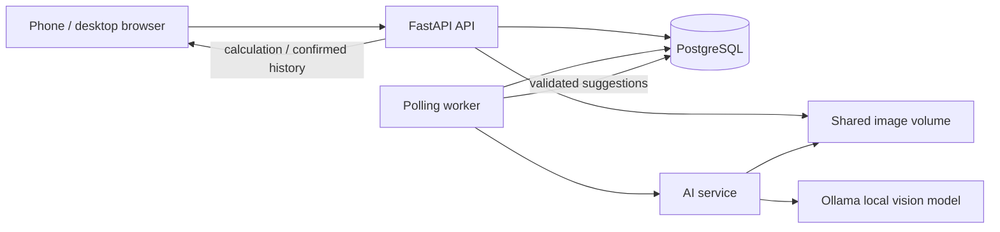

# Week 4 Submission — Team Architecture Proposal and Project Plan

## Team information

- Team name: group14
- Repository: https://github.com/Wzyoung203/MAIE6000C-starter-wzy
- Required checkpoint tag: `w04-proposal` (not yet created or pushed)
- Team members: Zhang Boxiang, Yang Sibo, Wang Ziyang, Li Zimu
- Project title: Photo-assisted Calorie Tracking App
- Selected brief: confirm the official brief title and compatibility before submission
- Status: proposal draft for team review; meal-domain implementation is planned

## 1. Problem context

Individuals who want to track everyday intake often find repeated manual food searching and entry inconvenient. Our app uses a photo to suggest food identities, lets the user correct them and supply portion weights, and calculates estimated calories from a traceable nutrition catalog.

The first release is a responsive browser app for simple meals and a small supported catalog. It supports general-wellness meal recording. Personalized diet-plan generation and body-profile collection are deferred so the core calorie-recording workflow remains buildable.

## 2. User workflow

**Photo → background recognition → user confirms food and grams → calorie calculation → persisted meal → daily total.**

1. User takes/uploads one photo and selects the eating time.
2. API validates and stores it; transactionally creates a meal and pending job; returns IDs with `202`.
3. Worker calls the AI service outside the upload request and persists validated suggestions.
4. User reviews food/preparation choices, adds ingredients, and supplies edible grams.
5. API validates the full list, calculates kcal, and persists confirmed items plus an immutable revision.
6. User sees history and totals for the selected local day.

Uncertain/unsupported food remains unresolved, without invented nutrition. Recognition failure allows manual selection on the same meal or a new recognition job. Manual entry is labeled and measured separately from real AI success. Late AI results cannot overwrite confirmed user input.

## 3. Success criteria

- **Product KPI:** valid photos reaching persisted confirmation / valid submitted photos. Week 7 target: all ten evaluation photos can be recorded, including visible manual fallback.
- **AI KPI:** at least eight of ten consented simple-food photos reach schema-valid, editable real-model suggestions. Report visible-food correctness separately; this is not calorie accuracy.
- **Operational KPI:** upload-to-review latency, job success/failure, retries/timeouts. Initial warm-model target: p95 under 60 seconds, subject to Week 5 measurements; report failures separately.
- **Durability:** reload and container restart preserve confirmed meals and daily totals without manual database intervention.

## 4. Architecture summary

- **UI:** responsive HTML/CSS/JavaScript served by API; upload, review, status, history and totals.
- **API:** input/image validation, meal/job creation, catalog search, calculation and confirmation.
- **PostgreSQL:** durable meals, source-backed catalog, analyses, corrections and job state.
- **Worker:** slow recognition, safe claim, bounded retries, expired-claim recovery and persistence.
- **AI service:** local-model adapter and structured-output validation; suggestions rather than calorie densities.
- **Image volume:** generated keys; API writes, AI reads; raw images stay outside PostgreSQL.

Reuse API → database → worker → AI → persisted result. Executable code still uses case triage and a keyword AI classifier. Meal features, safe claims and retry/recovery are proposed adaptations.

## 5. Data model and persistence plan

| Entity | Purpose |
|---|---|
| `users` | Stable owner/timezone; one demo user initially |
| `food_entries` | FDC entry, preparation state, kcal/100 g, source release/catalog version |
| `meals` | Owner, image reference, eating time, state, revision and confirmed total |
| `jobs` | Recognition state, attempts, retry time, claim token/lease and errors |
| `meal_analyses` | Original suggestions, model/prompt metadata, input hash |
| `meal_items` | Confirmed food references, grams, density snapshots and kcal |
| `meal_revisions` | Immutable full-item/total snapshots, reason and time |

Plan a local seed of about 20 verified **USDA FoodData Central SR Legacy, April 2018** entries from the [official downloads](https://fdc.nal.usda.gov/download-datasets/). Selection/import is Week 5 work. Runtime needs no nutrition API.

`item_kcal = grams × kcal_per_100g / 100`. Server uses decimal arithmetic and recalculates totals. Density snapshots/revisions prevent edits or catalog updates from silently rewriting history.

Store UTC eating times; calculate days using `Asia/Hong_Kong` initially. Only confirmed meals count toward daily kcal; show unconfirmed count separately. Full ERD/constraints: [architecture §6](../../docs/architecture.md#6-persistent-model-and-erd).

## 6. API / service plan

| Endpoint | Purpose |
|---|---|
| `POST /meals` | Validated upload and meal/job creation; `202` |
| `GET /meals/{meal_id}` | State, suggestions, confirmed items and revision |
| `GET /jobs/{job_id}` | State, attempts and safe errors |
| `GET /foods` | Supported nutrition search |
| `PUT /meals/{meal_id}/confirmation` | Full corrected list/revision; calculated and persisted kcal |
| `POST /meals/{meal_id}/retry` | New job for failed unconfirmed meal |
| `GET /meals` | Date-filtered paginated history |
| `GET /daily-summary` | Local-day confirmed kcal/count and unconfirmed count |
| `/health/live`, `/health/ready` | Health/dependency checks |

Internal `POST /analyze-meal` returns structured names/preparation hints/warnings with model metadata. Routes are proposed, not implemented. The first slice is private and single-demo-user; multiuser authentication is outside it.

## 7. Async / worker plan

Jobs: `pending → claimed → completed`; transient failure returns to pending within three attempts, terminal failure ends in `failed`.

Meals: `queued → processing → needs_review → confirmed`, with visible failure and manual confirmation available during failed/slow recognition.

Short PostgreSQL locking claims release transactions before inference. Defaults: two-second poll, 60-second worker request timeout, 50-second model timeout, 90-second lease, two/ten-second retry delays. Record attempts/errors, recover expired claims, reject late completion with a token, and enforce one analysis per job. Publication/confirmation lock the meal; late results or failures do not replace confirmed data.

## 8. AI-enabled component

AI identifies visible foods to reduce manual searching. User review addresses misidentification; catalog/application code handles calories. User supplies grams rather than relying on an accurate weight inference from one photo.

Proposed model: local `qwen2.5vl:3b`, listed as image-capable by [Ollama](https://ollama.com/library/qwen2.5vl). Hardware and food accuracy are unverified. Week 5 records hardware, versions and ten-photo results before treating it as feasible. Base plan requires no paid provider.

If unsuitable, narrow inputs or evaluate another available local model. If no genuine model path is feasible, document the blocker and discuss the plan with the instructor before Week 7. Fixtures/manual entry do not fulfill the real AI demonstration.

Preserve model/digest, prompt version, image hash, original suggestions, job and user revisions. All suggestions require confirmation; model uncertainty is not a calibrated probability. Use consented photos and ID/status/timing logs, without images or credentials.

## 9. Milestone plan

| Week | Deliverable / evidence |
|---|---|
| 5 | Feasibility results, verified seed, migration, first upload → persistent meal/job |
| 7 | Browser → real recognition → review → confirmation → daily total; ten-photo evaluation separates AI and fallback outcomes |
| 9 | Second member reproduces model/setup/seed, workflow and persistent images/records |
| 11 | Timeout/restart, exhaustion, duplicates and late-result race checks; latency/error measurements |
| 13 | Tested core workflow, final docs and reproducible genuine-model demonstration |

Assign a primary owner and reviewer to frontend/review; API/schema/calculation; AI/catalog/evaluation; worker/deployment/reliability. Individual assignments need agreement before Week 5. Detailed acceptance cases: [architecture §10](../../docs/architecture.md#10-milestones-and-work-allocation).

## 10. Risks and scope control

| Risk | Mitigation / fallback |
|---|---|
| Incorrect foods, hidden ingredients/weights | Mandatory review/grams, ingredient correction, visible estimates |
| Model hardware/latency | Week 5 measured gate, bounded inputs, available-model evaluation |
| Missing/wrong mappings | Verified source/preparation; unresolved items cannot silently become zero |
| Timeout/crash/duplicate result | Retry limit, lease/token checks, transactions and visible manual fallback |
| Semester scope growth | One complete photo-to-confirmed-record path first |

Cut first: automatic portions, multi-photo meals, rich charts/macros, native apps, broad mixed dishes, plans, profiles, predictions and social features. Keep genuine recognition, review, grams, traceable calculation, persistence and daily total.

## 11. Artifact index and submission checklist

- [Repository overview](../../README.md)
- [Architecture, diagrams/ERD, API draft, states, risk register and acceptance plan](../../docs/architecture.md)
- [AI Use Statement](ai-use-statement.md)
- [Exact Canvas record template](canvas-submission.txt)

Before the official checkpoint:

- [x] Team name confirmed as `group14` by Zhang Boxiang.
- [ ] Confirm official brief, scope and workstream owners.
- [ ] Team reviews architecture, nutrition/model assumptions and milestones.
- [ ] Complete actual team verification in the AI statement.
- [ ] Commit reviewed artifacts and create/push `w04-proposal`.
- [ ] Resolve the tag's full SHA and fill Canvas record.
- [ ] Submit official group record if Canvas is configured for groups.

## 12. AI Use Statement

OpenAI Codex assisted this revision by inspecting the starter, reviewing supplied assignment requirements, checking official model/data documentation and drafting the proposal. [ai-use-statement.md](ai-use-statement.md) records affected files, agent checks, changes and pending team review. No unperformed team review, model run or nutrition import is claimed.
